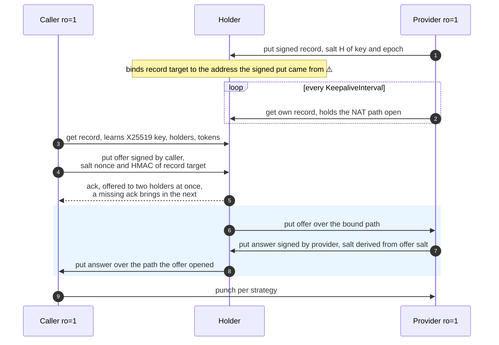

# warren (Go): Mainline-native discovery, signaling, and hole punching

A Go peer-to-peer connectivity stack that **is** a Mainline DHT node on the wire,
uses the DHT for signaling, and punches through NATs with measured, per-NAT
strategies. It borrows architecture, not wire format, from
[myleshorton/warren](https://github.com/myleshorton/warren) (Rust), whose own DHT is
deliberately incompatible with BitTorrent.

## Goals and constraints

- **Indistinguishable from BitTorrent DHT traffic**, as close to libtorrent as
  possible. Discovery runs in separate per-language community DHTs (see
  below), but every node also behaves as an ordinary Mainline node toward
  outsiders.
- **Survives national shutdowns** on the domestic internet (Iran, Russia, China).
- **DHT is the signaling plane.** There's no separate signaling service. Lantern-run
  nodes make it faster but aren't required.
- **State-of-the-art NAT traversal**, chosen per NAT from measured behavior.
- **Fits the iOS Network Extension** next to the sing-box datapath. radiance sets
  `GOMEMLIMIT=40MB` against a ~50 MB jetsam cap, and our budget target is under
  3–5 MB.

## Architecture (from Rust warren, kept)

- **Sans-IO core.** The DHT is a pure state machine that consumes datagrams and
  caller-supplied time and returns sends, events, and the next wakeup. One I/O
  goroutine drives it. Deterministic simulation and adversarial tests run against
  the same core that ships.
- **Every resource is bounded:** routing entries, candidates per lookup, in-flight
  RPCs, stored items, sockets per punch, probes per punch.
- **Admission diversity:** one identity per IP, at most 2 per /24 (or /64) per
  bucket, and 8 per prefix per table; lookups admit at most 8 candidates per
  prefix. Rust warren also tracks lookup provenance with per-origin quotas;
  that is planned here, not built.
- **Value retrieval during traversal** (BEP 44 `get` lookups return on the first
  verified value).
- **Blinded, rotating keys:** `H(key ‖ epoch)`. Providers publish the
  current epoch's record and keep the previous one until it ages out; callers
  try the current epoch, then the previous (both at once in the first ten
  minutes of an epoch, while the new record may still be spreading). Pre-publishing the next epoch is
  planned.

## Wire: Mainline as-is

| BEP | Use |
|---|---|
| 5 | KRPC (`krpc/`) |
| 32 | `nodes6` / `want` |
| 42 | Secure node IDs for server nodes, plus the `ip` field (our free reflector, see below) |
| 43 | `ro=1` for phones: query-only, never in routing tables, no storage |
| 44 | Signed mutable items: records and signaling |
| 51 | Planned: answer `sample_infohashes` like a normal node (today it gets `204 Method Unknown`) |

Security moves up a layer, because BEP 5 is plaintext and unauthenticated:

- **Authenticity:** BEP 44 ed25519 signatures on records.
- **Confidentiality:** encrypted BEP 44 values.
- **Unlinkability:** blinded keys.
- **Sybil and eclipse resistance:** BEP 42 plus local admission policy.

Fingerprint hygiene means matching libtorrent. `cmd/ltfingerprint` runs real
libtorrent 2.1.1 nodes next to ours on loopback and diffs every message kind:
key sets, transaction and token lengths, `v`, node counts, and `ip`. It exits
non-zero on any difference. The first run found three fingerprints, all fixed and
pinned by `TestLibtorrentWireHabits`:

- **`v` in every message.** libtorrent always sends `LT` + major +
  (minor<<4 | patch), so 2.1.1 is `LT\x02\x11`. We sent none.
- **`p` in every response:** the requester's port, alongside the top-level `ip`.
- **No `find_node`.** libtorrent builds bootstrap and refresh on `get_peers`. Our
  node-finding lookups now do the same.

Matching now covers message *shapes*. Timing (timeouts, retry cadence, refresh
intervals) is not compared yet. `natprobe` records the `v` distribution of live
responders: `LT 012f` (1.2.15) and `LT 0212` (2.1.2) are common, and about a
quarter send no `v`.

## Community overlays (language DHTs)

Deployments run separate DHTs per language community, for example Farsi, Russian,
and Chinese. A community includes people inside and outside the country, so during
an international shutdown the domestic part keeps working on the domestic internet.
Every overlay speaks unmodified libtorrent-style KRPC. Rust warren's regional design
marks overlays with a cleartext `WRO1` header plus an overlay ID, which identifies a
community passively. This design avoids that in four ways.

- **Membership in the node ID** (`overlay/`). BEP 42 fixes 21 bits plus the last
  byte. Bytes 15–18 carry a tag: the first 32 bits of SHA-256(community key ‖ rest
  of the ID). Members recognize each other from the `id` every message carries.
  There is no extra field. Without the key, IDs look like ordinary random BEP 42
  IDs. Each check takes 41 ns with zero allocations. Each community uses its own
  socket and ID.
- **Two personalities per node.** Queries from tagged IDs are answered from the
  community routing table. Everyone else gets ordinary libtorrent answers from a
  small real Mainline table (a few hundred entries, ~50 KB). Keyless active probing
  sees an ordinary BitTorrent node. During a shutdown, the domestic slice of
  Mainline keeps providing that cover.
- **Domestic copies.** Each record goes to the k closest nodes and to the k closest
  nodes inside the country's address ranges. When the border closes, foreign
  holders vanish and lookups converge on the domestic copies. This is simpler than
  Rust warren's separate IP-restricted local overlay, and it can be added later if
  measurement shows it's needed.
- **Partition detection.** When a large fraction of contacts time out together,
  switch to aggressive eviction, refresh, and republish rather than waiting out the
  normal timeouts. Persisted routing tables and invitations provide domestic
  bootstrap with no foreign dependency.
- **Isolation mode** (`dht/isolation.go`). This is a durable state: domestic
  contacts answer, and foreign ones have been silent for 3 minutes. Partition
  detection, by contrast, adapts to the new baseline within about 10 minutes.
  While isolated:
  - lookups skip foreign candidates;
  - holders re-put the community records they store, skipping a record that
    someone else already re-put this interval (as in original Kademlia);
  - remembered foreign contacts are probed every 2 minutes.

  One foreign answer ends isolation.

### Shutdown simulation (`sim/shutdown_test.go`)

Setup: a deterministic virtual network with 8 replicas, 2-hour record lifetime,
30-minute republish, and the border cut after a 75-minute warm-up. Readers are
domestic (half read-only phones, half routers). Columns are the share of
successful reads of domestically / foreign-published records.

**router-scarce:** 60 domestic routers, 180 abroad, and 200 domestic phones. 20% of
domestic routers go offline after the cut.

| After cut | plain | + domestic copies | + partition detection | + isolation mode |
|---|---|---|---|---|
| +1 min | 91 / 88 | 99 / 100 | 99 / 100 | 100 / 100 |
| +15 min | 100 / 90 | 100 / 100 | 100 / 100 | 100 / 100 |
| +2 h | 96 / 0 | 94 / 0 | 100 / 0 | 100 / 100 |
| +3 h | 84 / 0 | 80 / 0 | 82 / 0 | 100 / 100 |
| 30 min after reopening | 83 / 0 | 81 / 0 | 84 / 0 | 99 / 100 |

(An earlier version of this table came from a run whose churn schedule moved
simulated time backwards, so early rows saw later state. Departures are now
scheduled events and the simulator refuses to rewind time.)

Findings:

1. **Domestic copies fix the first hour.** Right after the cut, a record's
   replicas are known mainly to its ID-space neighbours, who are mostly dead
   foreigners. Domestic tables stay full of dead foreign entries and heal slowly.
2. **Record lifetime is the second cliff.** Records whose publisher is abroad, or
   whose domestic publisher went offline, expire 2 hours after their last put. Only
   holder re-replication keeps them alive.
3. **Plain Kademlia never re-merges after a long partition.** Each side evicts the
   other entirely, so neither table holds a cross-border contact once the border
   reopens. Neither side re-bootstraps, because its table isn't empty. In the
   balanced run, foreign-published records were still at 0% 30 minutes after
   reopening. Isolation mode's foreign probes reconnect the halves.
4. **The balanced run** (240 domestic, 80 abroad, no churn) shows only findings 2
   and 3. With mostly domestic routers, replica placement alone survives the cut.

The simulation does not model NAT, packet loss, provider-level splits inside the
country, or adversarial nodes. It shows the protocol logic is sound. Real-world
numbers still need field measurement, starting with the router-supply survey.

**The main survival risk is router supply.** Most Iranian mobile users sit behind
CGNAT and can only be read-only (`ro=1`) clients. The overlay needs enough
reachable domestic nodes: broadband, mobile IPv6, and NATs that accept unsolicited
traffic. We can measure this from outside before any shutdown: the vantage survey
asks what fraction of domestic Mainline nodes answer unsolicited pings, by ASN.

**Limit:** the key ships in the app. A censor who extracts it can check tags on
every packet. The tag defeats generic DHT fingerprinting and keyless probing. It
can't hide an open community from a censor running a per-community MAC check.

## Signaling (`dht/signal.go`)

This follows HyperDHT's design, in which the nodes holding a provider's record
relay its handshake, but every message is a standard BEP 44 `get` or `put`. In a
community overlay every node runs our code, so **record holders are the
coordinators**. The signaling path needs no Lantern infrastructure, and during a
shutdown the domestic holders keep relaying.



**Wire encoding:**
- **Record:** `k` is the provider's key, `salt = H(key ‖ hourly epoch)`, and `v` is
  `{"x": X25519 key}`. Callers try the current epoch, then the previous one.
- **Offer:** `k` is the caller's key, `salt = nonce ‖ HMAC(record target, nonce)`,
  and `v` is `ephemeral X25519 key ‖ AES-256-GCM(payload)`, with keys from
  HKDF-SHA256. A holder can match the salt against the records it binds. An
  observer can't link it to the provider without knowing the record target.
- **Answer:** `k` is the provider's key, `salt = H(offer salt)`, and `v` is
  encrypted under the answer key. The caller checks that the signer is the
  provider it called.
- **Delivery:** forwarded items arrive as `put` queries. Read-only nodes
  intercept them before ignoring queries.

**Security:**
- **Binding:** only a signed put binds or rebinds a record to an address. A
  replayed put from elsewhere can't move a binding the provider keeps fresh, and
  keepalives from other addresses don't refresh it (`TestBindingResistsReplay`).
- **Address changes:** a provider that sees its mapped address change in a
  keepalive reply re-signs with a higher sequence number, which rebinds.
- **Holder trust:** offers and answers are end to end encrypted and signed, so a
  holder can drop them but can't read or forge them.
- **Replay:** offers older than 60 seconds are rejected, and each offer salt is
  accepted once.

**Simulated latency, including the record lookup:**
- phone to phone: 683 ms (824 ms before the lookup and offer changes below);
- with the first holder dead: 1.53 s (1.19 s before; the record lookup now
  walks on past dead nodes rather than ending short, see *Performance against
  libtorrent*, and single simulated runs vary by a few hundred ms);
- an hour into a shutdown, through domestic holders: 334 ms.

The loopback UDP test completes in about 11 ms.

Two fixes came out of this work:
- **Ack-based failover.** A caller fails over after a missing ack (one round trip)
  rather than after the full 2.5-second answer window. It offers to two holders
  at once: the provider takes the first copy and answers through every holder
  that relays one, so a dead or slow holder costs nothing while another works.
- **Lookups no longer wait on slow queries.** Like libtorrent, queries past the
  short timeout no longer hold a lookup open. Previously one dead node near the
  target added a full query timeout to every lookup that passed it.

**Keepalive cadence.** HyperDHT pings its relays every 3 seconds, which is far
from libtorrent's cadence and costly on phones. Our keepalive must only beat the
NAT's UDP mapping timeout. `natprobe.MappingTimeout` measures it: each idle gap
runs on its own socket, and a changed BEP 42 port means the mapping expired.
`KeepaliveFor` then picks 80% of the longest surviving gap, never below 10
seconds, defaulting to 25 seconds. Port-preserving NATs reuse the same port for a
new mapping, so they need a cooperating vantage to measure.

**Open question:** `put` queries delivered to read-only nodes. libtorrent never
queries `ro=1` nodes, so a stateful observer could notice. The alternative is to
deliver by answering the provider's own keepalive `get`, which looks normal but
adds up to one keepalive interval of latency.

## NAT traversal (`punch/`)

`punch` is a sans-IO engine like `dht`. A `Session` owns numbered virtual
sockets, takes datagrams and time, and returns sends and events. `Runner`
drives it over real UDP: it opens extra sockets on demand, closes the losing
ones, and hands back the nominated socket.

**Probes are KRPC pings.** Each side's node ID derives from a secret shared
through the encrypted signaling offer, so probes can't be forged. On the wire a
punch looks like two DHT nodes pinging each other; birthday sprays still look
like many pings to one IP. Each offer carries the side's candidates and NAT
profile: mapping type, allocation pattern, sequential step, and port block. It
encodes in under 200 bytes.

**Plan (`punch/plan.go`)** chooses from mapping and allocation, not an
open/consistent/random label:

| Local \ peer | independent | dependent |
|---|---|---|
| independent | direct simultaneous open | **spray** the peer's predicted window (sequential), its block, or the full range |
| dependent | **open** sockets toward the peer | **double birthday** when both ranges are known, otherwise relay |

**Probe authentication.** Probe IDs are static per-session values derived
from the secret, so an off-path attacker can't forge one. An on-path observer
who sees a probe could race a copy from its own address and get that address
nominated. That is accepted: an on-path attacker can already drop the
packets, and impersonation still fails, because hysteria2 pins the provider's
key and derives its password from the secret.

**Inbound punches are rate-limited** (`endpoint/limit.go`), so a forged offer
naming a victim can't turn a listener into a probe reflector:
- per caller key, checked first so one key can't spend the shared budgets;
- per probed network: public candidates by /24 (or /48), non-public ones by
  exact address;
- relays twice: by exact address, and by network in a separate, looser bucket,
  so routers sharing a /24 don't lock each other out but a victim network is
  still capped;
- global budgets, charged by the planner's actual strategy: a tight one for
  probe-heavy punches (spray, open sockets, double birthday) and a looser one
  for all punches.

Checks never write on refusal, so attempts from ever-new keys can't grow the
tables.

A responder also never sprays a non-public address. Doing so would port-scan
its own LAN or localhost on a stranger's request. LAN candidates get only
direct probes. Keys are free to mint, so a determined attacker can still
exhaust the global spray budget; `Authorize` is the defense for a listener
under attack.

**The initiator nominates** the first confirmed path. Responses are matched by
**transaction ID, not source address**, as ICE does. Under dependent mapping a
reply comes from a new port; nominating that port would mint fresh mappings on
every round trip, so the initiator keeps its probed destination.

**Port budget.** With dependent mapping, every new destination costs a NAT port.
A carrier NAT's per-subscriber quota may be only about 2,000, shared with the
VPN tunnel and everything else on the phone. The double birthday therefore
probes a fixed set of at most size/8 (and no more than 256) socket-and-port
pairs and re-sends on them. That gives about size/64 expected hits and caps the
cost of a failed attempt at about 259 ports. An earlier version drew a new port
on every round and exhausted a 2,048-port block in 3 seconds.

**Success matrix** (`punch/matrix_test.go`). This uses the RFC 4787 NAT model in
`sim/nat.go`, 40 seeds per pair. The baseline is HyperDHT-style: it knows only
consistent versus random mapping and refuses pairs where both map dependently.

| Pair | Ours | Baseline |
|---|---|---|
| public with anything, cone ↔ cone | 100% | 100% |
| cone ↔ sequential | 100% | 82% |
| cone ↔ port block | 100% | 85% |
| **carrier block (address filtering) ↔ carrier block** | **100%** | **0%** |
| cone ↔ random | 92% | 92% |
| dependent ↔ dependent with address-and-port filtering, or a random allocator | 0–2% | 0% |

Cone ↔ random matches the budget's prediction: 2,400 spray probes against 64
sockets give 1 − (1 − 64/64512)^2400 ≈ 91%. A faster spray reaches 99% at the
cost of more traffic.

In this standalone matrix the zeros have no relay. The full stack sends them
through a router relay (see *Relay fallback*). Filtering measurements would let
the planner skip doomed double birthdays, and port mapping (PCP/UPnP) would
avoid the relay for some of them; neither is built yet. IPv6 (see *IPv6*)
avoids it for peers with public IPv6 addresses.

Times to connect in the model: 0.24–0.5 s for direct and spray, 1.6 s for
cone ↔ random, 0.28 s for the double birthday. The real-UDP runner is tested on
loopback for direct and open strategies; relay-needed pairs fail fast without
probing.

**Handoff.** Once connected, the socket belongs to the application, which
can't answer punch traffic. The responder sends its final acknowledgement
three times. On a direct path, the initiator connects after five unanswered
nominations, provided the peer already answered one of its own probes on that
pair (so the path is known to work both ways). A few stray control datagrams
can reach the application afterwards; layers above drop them, and
`endpoint.Conn.Recv` skips them.

**Still to come:** PCP/NAT-PMP/UPnP (Tailscale's `portmapper` is
a candidate); low-TTL priming; filtering-aware planning. Extra sockets come
from the endpoint's open-file budget (see *Open files* under the data
plane).

## Connecting by public key (`endpoint/`)

`Endpoint.Connect(ctx, identity, peerKey)` returns a connected UDP socket. The
provider side uses `Listen` and `Accept`.

1. Bind a fresh data socket. Learn its public address by pinging DHT contacts,
   which return the BEP 42 `ip` field.
2. Send a punch offer (candidates, NAT profile, 32-byte secret) as the signaling
   payload. The provider answers with its own candidates and profile, gathered
   on its own fresh socket.
3. Punch with the planned strategy. The winning socket is returned and the rest
   are closed.

**Authentication.** Only the provider's private key can decrypt the offer, the
answer is signed by that key, and probes carry IDs derived from the secret. So
the caller knows it reached the provider, and `Conn.PeerKey` on the provider is
the caller's verified key. `Conn.Secret` is shared only by the two ends, for
binding the coming QUIC or Noise handshake to this path.

**NAT profile.** It's inferred passively from the DHT socket's BEP 42
reflections, since the same NAT maps the data sockets, using `natprobe.Analyze`.
No probe traffic is involved. `Config.Profile` overrides it.

**Other behavior:**
- `Authorize` rejects callers with **silence** rather than a refusal, so a probe
  learns nothing beyond the public record.
- `MaxInbound` (default 8) bounds concurrent inbound punches and the sockets
  they hold.
- The signaling answer window is now 4 seconds, because providers gather before
  answering. Dead holders are still detected by the missing ack, after about a
  round trip (the adaptive short timeout, at most 1 second).

Loopback tests cover connect plus data both ways (about 10 ms), three concurrent
callers, an unknown key (`ErrNoRecord`), and authorization. They are race-clean
over 10 runs.

**Full stack through modeled NATs** (`sim/fullstack_test.go`). The simulator now
puts hosts behind the RFC 4787 NAT model, with a DHT socket plus data sockets
carrying punch sessions. The test runs endpoint's exact flow between read-only
phones: gather via DHT contacts, signal, the provider gathers and answers, both
punch. It covers records bound through the provider's NAT (one binding per
holder, even under dependent mapping), keepalives holding those mappings open,
offers and answers forwarded through NATs, and passive NAT inference from DHT
reflections. Every inference was correct. Four seeds per pair:

| Provider ↔ caller | Connected | Median time* | Strategy |
|---|---|---|---|
| cone ↔ cone | 4/4 | 1.62 s | direct |
| cone ↔ carrier block | 4/4 | 1.64 s | open |
| carrier block ↔ carrier block | 4/4 | 1.65 s | double birthday |
| cone ↔ sequential | 4/4 | 1.52 s | open |
| cone ↔ random | 4/4 | 4.39 s | open |
| sequential ↔ sequential (strict filtering on both sides) | 4/4 | 4.66 s | relay, after the direct attempt |
| carrier block ↔ random | 4/4 | 1.64 s | relay, immediately |

Before the relay existed, the last two pairs connected 0/4.

\*Includes a fixed 1-second gather wait in the test. The endpoint proceeds on
the first reflection.

## Relay fallback (`dht/relay.go`, `punch/relay.go`)

Pairs with no direct path (strict filtering on both sides, or a random
allocator on a hard side) go through a **router relay drawn from the swarm**.
Lantern's own proxies may be unreachable during a shutdown, so this follows
HyperDHT's volunteer blind relays rather than depending on Lantern
infrastructure.

- **Binding is a standard `announce_peer`.** Both peers' data sockets announce
  the same secret-derived info-hash to router R (`get_peers` for a token, then
  `announce_peer` with `implied_port`). R pairs the two announcers.
- **Forwarding is blind.** R passes non-KRPC datagrams between the paired
  addresses. The payload is end-to-end encrypted hysteria2. To an observer,
  each peer announced a torrent to a DHT node and then talked uTP with it,
  which libtorrent does on the same socket.
- **The relay is negotiated.** The caller offers up to eight of its DHT
  contacts as candidates. The listener picks one and names it in its answer,
  and both sides bind it in parallel with punching, so falling back is instant.
  Relay probes are authenticated datagrams shaped like uTP `SYN`/`STATE`. Probing
  starts immediately when the plan has no direct strategy, and otherwise
  halfway to the punch deadline, so a direct path always wins. Both sides
  probe. The listener answers the caller's probe with three acks and hands
  off; if every ack is lost, the caller, having seen the listener's probes,
  connects after five unanswered probes, as on a direct path.
- **Volunteer cost is bounded.** Routers relay by default (`DisableRelay` opts
  out), with at most 16 pairs at once (`MaxRelayPairs`) and 512 KB/s per pair
  (`RelayRate`, a token bucket; packets over budget are dropped, so end-to-end
  congestion control backs off). Pairs are fixed once formed, so a third
  announcer can't join or hijack them. Idle pairs expire after a minute, and
  read-only phones never relay.
- **Admission is loose by design.** An address relays one pair. A source (an
  IPv4 address or IPv6 /64; all link-local senders share one) holds at most
  8 half-formed pairs and one pair with itself. A full table evicts a
  half-formed pair rather than refusing new ones: from the source holding
  the most, oldest created first, never one created less than ten seconds
  ago (long enough for its peer to arrive), unless every pair is that
  young, in which case the oldest pair of another source no lighter than
  the newcomer's goes (a newcomer whose source is strictly the heaviest is
  refused until a pair passes its grace, and retries). At its cap, a source's own oldest stale pair makes way, so one
  subscriber behind a shared address can't pin its budget. Creation time,
  not activity, decides, so refreshing can't protect a pair. Under a flood
  from many single-pair sources the router can't tell newcomers from
  attackers, so the guarantee is first in, first out: a pair survives one
  full table turnover: the evictable slots (4×`MaxRelayPairs` less the
  complete pairs, at most 64) divided by the flood rate, at most about 6
  seconds at 10 announces a second, enough for its peer to arrive. A faster
  flood from that many addresses can deny relaying through that router, and
  sessions then fall back at their deadline. Clients re-announce every
  second until they hear their peer through the relay, so an evicted pair
  is rebuilt. Tighter per-source limits would hit CGNAT users and relay-only
  listeners as hard as attackers. So pairs between different sources are
  bounded only by the pair cap, the byte budget and idle expiry, the
  open-relay limit every volunteer relay shares.
- **Each relay-only side trusts only routers it knows.** A relay learns both
  addresses. A relay-only listener picks the first offered candidate it has
  authenticated itself, or else its own closest contact. A relay-only caller
  accepts the listener's pick only if it was one of its own candidates. Two
  relay-only peers that share no known router can't connect.
- **Relay-only privacy mode** (`endpoint.Config.RelayOnly`, `punch.Config.RelayOnly`).
  The offer carries no candidates and the peer is never probed directly, so a
  peer sees only the relay, never your IP. The relay router still sees both
  ends.

Tests: router rules (pairing, no hijack, byte budget, pair limit, opt-out),
the full-stack NAT simulation above, and a real-UDP relayed `Connect` with
hysteria2 over uTP through the relay (about 10 ms on loopback).

## Data plane: hysteria2 shaped as BitTorrent uTP (`utpshape/`, `transport/hy2/`)

Plain QUIC is blocked in several target countries, Iran included, so the
punched socket carries **hysteria2** (sing-quic, the same engine lantern-box's
hysteria2x uses). It brings Brutal congestion control for congested, censored
links, and BBR otherwise. BBR is the default between phones, because Brutal on
a mobile uplink can starve the user's own traffic.

Underneath hysteria2 sits a pluggable obfuscation layer:

- **uTP shaping (`utpshape`, the default).** Every datagram gets a real 20-byte
  BitTorrent uTP header (BEP 29): consistent connection IDs, incrementing
  sequence numbers, acks of the peer's sequence, and microsecond timestamps.
  Connections open with an empty `ST_SYN` answered by `ST_STATE`. The payload is
  AES-CTR encrypted, so it looks like encrypted (MSE) BitTorrent. The IV is the
  header's own fields, so the header is the only overhead. Wireshark's dissector
  parses every packet as uTP, with data packets shown as **BitTorrent over uTP**
  (`TestWiresharkSeesUTP`). It also matches the DHT cover exactly: libtorrent
  runs DHT and uTP on one UDP socket, so DHT pings followed by uTP on the same
  socket is ordinary BitTorrent behavior.
- **Salamander** (hysteria2's): random-looking datagrams.
- **None:** plain QUIC, for regions where QUIC passes. Outline's `quicprelude`
  and hysteria2x's `pre_initial_junk` belong here: they defeat SNI inspection
  of QUIC but leave it recognizable as QUIC.

**Speed.** Shaping costs 243 ns per 1,200-byte packet (about 4.9 GB/s on one
core). hysteria2 over loopback, which is CPU-bound:

| Mode | MB/s |
|---|---|
| plain QUIC | 166 |
| uTP-shaped | 123 |
| Salamander | 94 |

The remaining gap to plain QUIC is per-packet syscalls: a wrapped socket loses
quic-go's batched UDP paths. Recovering GSO and batching, which matters for
servers, is follow-up work. On real mobile links every mode is link-bound, and
uTP's cost is about 1.5% in header bytes.

**MTU.** `utpshape` sets Don't-Fragment on the socket (`IP_DONTFRAG` on Darwin,
`IP_MTU_DISCOVER` on Linux). QUIC's MTU discovery then measures the real path
including the 20-byte header: a probe of size S succeeds only if S+20 fits.
Without Don't-Fragment, it stays at 1,200 bytes (1,220 on the wire, inside the
IPv6 minimum MTU).

**Authentication.** The provider's TLS certificate is generated from its
ed25519 key, and the caller pins that key (an impostor fails the handshake with
`certificate is not the peer's key`). The hysteria2 password and the uTP key
derive from the session secret via `hy2.FromSecret`.

**iOS.** hysteria2's 8 MiB stream and 20 MiB connection receive windows are
capped to 1 MiB and 2.5 MiB through `QUICOptions`, with no fork needed. The
engine is already linked into the Network Extension through lantern-box.

Measured Go heap and stack growth (`TestPhoneMemory`, in-process), on macOS
and built for iOS and run in the iOS simulator (`tools/iossim/run.sh`):

| Phone state | macOS | iOS simulator |
|---|---|---|
| read-only DHT node, bootstrapped, idle | 0.04 MiB | 0.06 MiB |
| listening as a provider | 0.26 MiB | 0.22 MiB |
| 64 MiB transfer behind a slow reader, capped windows, both ends | 7.6 MiB peak | 7.4 MiB peak |
| same, hysteria2's default windows | 23.6 MiB peak | 26.2 MiB peak |

Every package also builds for an iOS device (`GOOS=ios GOARCH=arm64`, the
iPhoneOS SDK). These are Go heap and stack figures, what warren allocates; the
process's `phys_footprint`, which jetsam judges, also counts the runtime and
native memory, and needs a device.

The DHT is effectively free. The transfer cost is the receive buffer, about
3.8 MiB per end with caps versus about 12 MiB with the defaults, so **the caps
are mandatory**. They still allow about 100 Mbps at 200 ms round-trip time.

**Open files.** The open and birthday strategies want up to 64 extra sockets
a punch, and with `MaxInbound` inbound punches over two families an
unbounded endpoint could ask for over a thousand descriptors, in a process
that shares its open-file limit with the VPN's datapath. The endpoint keeps
a budget of extra punch sockets (`MaxPunchSockets`: by default a quarter of
the soft `RLIMIT_NOFILE`, between 16 and 512, read at run time). A punch
reserves sockets when it plans (`punch.Config.Reserve`), only for a strategy
that needs them, and returns them when the punch ends. Granted fewer, it
punches with fewer; granted none, it falls back to its relay, or probes
from its own socket alone. The simulator shares the Mac's kernel limits, so
a device's limit is still to be read.

**Memory pressure.** A memory monitor in the host (radiance's `memmon`
closes the oldest connections at its soft level, all of them at its hard
level, and refuses new ones in between) reaches warren's connections through
`Endpoint.Connections`, `CloseOldest`, `CloseAll` and `SetRefusing`. A
connection's memory is its protocol's receive buffers, freed when the layer
above sees the `Conn` close; the DHT, a fraction of a MiB, keeps running, so
the phone stays reachable. While refusing, `Connect` fails with
`ErrRefusing` and a caller's offer is answered at once, empty, so it fails
fast; a punch already in flight adds no connection either, so
`SetRefusing(true)` then `CloseAll` leaves none. A resume still moves a live
session. Connections shed while waiting for `Accept` are skipped and give
up their queue slots.

**Shaper interface.** `hy2.Shaper` (wrap a socket, declare per-packet overhead,
optionally report Don't-Fragment) separates the transport from the
obfuscation. `utpshape` is one implementation. The spec-driven shaping engine
(design in `docs/shaping-design.md`) plugs in the same way. QUIC's initial
packet size comes from the declared overhead.

**As a general transport.** `utpshape` is a plain `net.PacketConn` wrapper with
per-peer state, so one server socket serves many clients. That makes it a
candidate hysteria2 obfuscation mode for lantern-box client-to-server traffic as
well. The client side slots into hysteria2x's dialer hook, as `pre_initial_junk`
does today. The server needs a hysteria2x inbound that wraps its listener
before `Service.Start`, since a stock hysteria2 server can't unwrap uTP.

## IPv6 (built)

Large mobile networks (China Mobile above all, and increasingly carriers in
Russia and Iran) give phones public IPv6 addresses. Two such peers usually
connect directly: there is no address translation, only a stateful firewall,
which a simultaneous open passes. That raises the success rate and takes load
off relays, so IPv6 comes before network-change rebind, which must handle a
family change anyway.

To look like libtorrent, IPv6 is a second DHT node, not more entries in one
table. libtorrent runs one node per listen socket and address family, each
with its own BEP 42 ID (derived from that family's external address), its
own routing table, and `nodes` or `nodes6` in its replies. A query whose
`want` asks for the other family is answered from the sibling node's table
(libtorrent's `get_foreign_node`). Warren does the same:

- **DHT (`dht/`).** A node can be given a sibling. Referrals for the other
  family come from the sibling's table of the same personality (community or
  Mainline). Everything else stays per node: IDs, tables, storage, tokens.
- **Driver (`driver/`).** `ListenDual` binds an IPv4 and an IPv6 socket and
  runs both nodes on the one loop goroutine, so the core stays
  single-threaded and siblings can call each other directly. Operations go to
  both nodes: bootstrap and publish on each, and the first successful get
  wins. A host that can't bind IPv6 runs the IPv4 node alone; one that
  binds IPv6 but has no IPv6 peers skips the IPv6 leg when connecting.
- **Signaling.** A provider listens on both nodes, so it has a record under
  each family. A caller signals over every family it has and takes the first
  answer.
- **Endpoint and punching (`endpoint/`, `punch/`).** Each family gets its own
  data socket and punch session (a leg). Offers carry candidates of both
  families plus an IPv6 profile (`p6`). The caller races the legs, IPv6
  first with a 200 ms head start (happy eyeballs, `HeadStart`), and the
  first connected path wins; the other leg stops and releases its sockets.
  IPv6 peers with public addresses plan as endpoint-independent, so the
  common case is a direct simultaneous open. The caller's legs share one
  claim, so only one family is ever nominated and both sides keep the same
  path, and the provider punches a dual-stack caller's offer once though it
  arrives through both DHTs. While IPv6 races, the IPv4 leg on both sides
  waits out the head start and holds IPv4 relay probes until halfway to the
  deadline, since the caller's relay probe commits the responder. The
  provider runs an IPv4 leg only for an offer with IPv4 candidates or
  relays. The endpoint negotiates relays for its IPv4 leg
  only (an IPv6 DHT node still volunteers as a router), and a relay-only
  endpoint never opens an IPv6 leg, since that leg punches directly and
  would reveal its address; it refuses to start without an IPv4 socket.

Loopback tests cover a provider listening on both families signaled by an
IPv4-only and an IPv6-only caller, two dual-stack endpoints connecting over
IPv6 and running hysteria2 over uTP through it, a dual-stack caller falling
back to IPv4 against an IPv4-only provider (with one limiter charge per
dual-stack connect), and a relay-only endpoint keeping IPv6 out of its
offers. Unit tests cover the driver's session table (a session admitted
once across families) and two sessions sharing a claim in lockstep. Gaps: `Snapshot` saves only the primary
node, so a restart rejoins the IPv6 DHT by bootstrapping; relays don't
carry IPv6 yet; and the NAT simulation models IPv4 only.

## Network changes (`Rebind`, built)

A phone moves between Wi-Fi and cellular, or gets a new address, many times
a day. Its DHT sockets, every NAT mapping, and every record holder's
forwarding binding then point at an address that no longer exists, so
callers can't reach it.

- **`driver.Node.Rebind`** replaces each family's socket on the loop
  goroutine and keeps everything else: routing tables (contacts' addresses
  didn't change), stored items, records and tokens. An ephemeral port gets a
  new one; a fixed port is reused when it can be, else falls back to
  ephemeral.
- **`dht.Node.Rebound`** then forgets the old network's reflections, abandons
  queries in flight from the old socket (without counting them against the
  peers), so a late reply can't restore an old mapping or finish an old
  publication, drops write tokens bound to the old address, and when
  listening marks its records due, so they are re-signed with a newer seq
  and republished at once, and polls its holders. Holders move a forwarding
  binding only on a strictly newer signed put, so republishing the old seq
  would leave offers going to the dead address.
- **`endpoint.Endpoint.Rebind`** exposes it. Apps call it from the platform's
  change notification (iOS `NWPathMonitor`, Android `ConnectivityManager`).
  `WatchNetwork` is a fallback that checks the default routes' local
  addresses every few seconds without sending a packet.

**Live sessions migrate.** An `endpoint.Conn` is a stable virtual path: it
reports a fixed peer address (`Remote`) while the real socket and the peer's
real address underneath can be swapped, so hysteria2, QUIC and uTP shaping
above see one unchanging path. `Conn.Migrate` signals the provider again
with a resume ID derived from the connection's secret, which only the two
ends hold; both sides punch a fresh path (direct over either family, or
relayed over IPv4), and the provider, matching the ID and the caller's verified
key to a live inbound connection, swaps the new socket into it instead of
handing a new connection to `Accept`. QUIC retransmits what was in flight;
the hysteria2 password and pinned TLS stay valid because they derive from
the original secret. `Endpoint.Rebind` migrates every outbound connection.
A provider that moves can't migrate its inbound connections itself (the
caller may not be listening): the caller notices the session stalled and
migrates.

**Stalls migrate on their own.** A path can die with no network change on
the caller's side, so `Rebind` never runs: the provider moved, a NAT dropped
its mapping, a relay went away. Each path notes when it sent a datagram the
peer hasn't answered, and a stall watcher, running once a second only while
the endpoint has outbound connections, migrates any connection whose
provider has been silent for `StallTimeout` (5 seconds) after being sent
something that expects an answer. QUIC acknowledges ack-eliciting packets
within a round trip, so a live path answers in time. A bare acknowledgment
gets no answer, so a datagram sent within a second of one arriving doesn't
start the wait; otherwise acknowledging the provider's keepalive would make
an idle session look stalled until our own keepalive 10 seconds later. A
request that goes unanswered is retransmitted later than that and starts
the wait then. A send that fails as a lost packet (no route) starts it too,
so a path whose route vanished is judged stalled. An idle session (nothing
sent) is never judged. Five seconds also leaves a migration time to finish
before QUIC's 30-second idle timeout ends the session. Silence costs no
probe packets: the session's own traffic is the probe. A failed stall
migration backs off while the same wait goes unanswered, doubling from the
timeout to 30 seconds (a new wait or path starts again), since a
provider that is gone rather than moved would otherwise be signaled through
the DHT every second until the layer above gives up. A stall move isn't
a migration request, so a failed one isn't retried by `WatchNetwork` around
that backoff, and one queued behind another migration does nothing once
that migration replaced the path or the provider answered. Silence is measured
over datagrams the application reads, so a raw connection that writes
without reading turns detection off (negative `StallTimeout`).

Resumes have their own budget, 6 a minute per connection, instead of the
new-connection limiter's few per caller, so several sessions moving to one
provider aren't stranded. They still count against the global budgets,
and a heavy one (spray, open, double birthday) against every network it
probes: owning a session doesn't buy sprays at addresses of the caller's
choosing. Each migration carries a sequence number, and the provider
installs only a newer one, so a slow resume can't overwrite a later path. A write that
picked a socket just as a swap closed it follows the path to the new one,
since QUIC treats a write error as fatal. Because QUIC never sees the path
change, it can't reset what it learned about the old one, so a migratable
connection keeps it from path MTU discovery (packets stay at QUIC's safe
1200-byte initial size): a size found on one network would be dropped on a
smaller-MTU network after a move. Rebind migrates even when a DHT family
failed to rebind, and `WatchNetwork` retries what's left.

This works below QUIC rather than with QUIC's own connection migration:
that lets only the client move, needs the peer's NAT to admit the new
address anyway (a new punch either way), and would need the QUIC connection
that sing-quic's hysteria2 client keeps private. The cost is that QUIC
connection IDs don't rotate across the move, so an observer on both
networks could link the two paths.
Full (non-read-only) nodes keep their node ID across the change, though
BEP 42 derives it from the external address; phones are read-only, so this
only matters for routers that move, which are rare.

Tests cover a provider signaled before and after a rebind onto a new port
(without the republish it is unreachable), a fixed port reused, both
families rebinding, a fresh `Connect` after the provider rebinds, and
`WatchNetwork` rebinding on a route change and not otherwise, a hysteria2
stream echoing across an explicit `Migrate` and across a caller `Rebind`
(both ends on new sockets), and a resume accepted only from the
connection's own caller, failing fast when it names nothing.

## Performance against libtorrent (`cmd/dhtbench`)

`cmd/dhtbench` runs a warren node and a libtorrent 2.1.1 node
(`tools/dhtbench/lt_bench.py`) on the same host at the same time, both full
nodes bootstrapped from the same public routers on live Mainline, and
measures:

- how fast each fills its routing table;
- **hits**: immutable gets for items a third (warren) node stored, so neither
  measured node has walked toward them; the time to the first matching value
  is a proxy for signaling's provider-record lookup, which understates it:
  that lookup is a mutable get, which keeps walking after a valid record
  arrives until no query is left;
- **misses**: gets to random targets, a full walk to the closest nodes.

A finished lookup reports its `dht.Timing` (first response, when the K
closest responders last changed, total) and failures; both sides' totals
are wall-clock times around the get call. Flags set warren's in-flight cap,
alpha and timeouts for experiments. All nodes share the host's public
address, and Mainline nodes keep one ID per address in their tables, so
remote tables may hold only one of them; the comparison is between nodes
that face the network the same way, not a clean-room benchmark. Baseline
(100 lookups a phase, 4 in flight, nearest-rank percentiles; hit times
count only found values, and with under 100 of them p99 is the worst):

| | warren | libtorrent |
|---|---|---|
| hit, p50 / p90 / worst | 951 / 3,345 / 9,892 ms | 416 / 670 / 2,384 ms |
| hits found | 98 of 100 | 99 of 100 |
| miss, p50 | 7.3 s | 18.2 s |
| routing table at 60 s | 103 nodes | 52 nodes |

A run before the last fixes to the harness measured the same shape (hit p50
1,038 against 418 ms, p90 3,341 against 678 ms).

warren's first response comes at about 70 to 180 ms, but about half the
queries a miss sends fail (14 of 30 a lookup: timeouts, plus the few replies
rejected for the wrong ID or an error), and with at most 6 queries in flight
and a fixed 1 s before a slow query stops counting as active, a few dead
nodes stall a lookup until the 3 s timeout. In an earlier warren-only run of
four variants side by side (computed with an earlier percentile formula; its
default variant measured a hit p50, p90 and worst of 1.07, 3.8 and 7.6 s),
raising the in-flight cap to 16 and the
short timeout to 300 ms together cut the p90 to 1.7 s and the worst to 2.8 s;
neither alone helped much. The hit median, about 0.9 to 1.1 s across runs
against libtorrent's 0.42 s, is unchanged by tuning: about 12 queries a hit
points at hop count and routing-table quality. On a miss warren
concludes sooner than libtorrent but still spends about 2 s past the moment
its K closest settled. Live numbers vary run to run.

CPU, from benchmarks: decoding a response with 8 nodes takes 1.1 µs and 9
allocations, encoding one 0.3 µs and 12; answering a `find_node` or
`get_peers` takes about 12 µs and 35 allocations, three quarters of it
sorting the whole routing table to find the closest contacts.

**Tuning (built).** Lookups now allow 16 queries in flight (from 6), and a
query counts as slow, so the lookup widens past it, at an adaptive short
timeout: the node's smoothed round trip plus four deviations (RFC 6298
style), between 250 ms and `ShortTimeout` (1 s), which is used until a few
replies are timed. A slow query still holds the lookup open until 1 s, as
before, since a slow node near the target may hold the value; past that it
also leaves the lookup's frontier, so a dead node can't occupy a closest slot
and end the lookup before it reaches the next candidate. That last rule came
from the shutdown simulation: widening early with a short timeout filled the
frontier with newly dead foreign nodes right after a border cut, and
isolation-mode reads fell below 98 % until lapsed queries left it.

Measured live, the old and new code side by side at the same moment (150
hits each, warren only; an earlier run showed the same shape, at 1.69 to
1.19 s p50 and 3.83 to 2.49 s p90):

| | before | after |
|---|---|---|
| hit, p50 / p90 / p99 | 1,357 / 3,929 / 6,922 ms | 1,009 / 1,834 / 3,378 ms |
| hits found | 148 of 150 | 150 of 150 |
| queries a hit | 12.8 | 14.4 |

Signaling offers to two holders at once (see *Signaling*), and a holder
that misses its ack at the adaptive short timeout is late, not dropped: the
next one is brought in, and the late one is given up on only at 1 s. A
holder that rejects the offer is dropped at once. An offer the node can't
send for a full transaction table keeps its holder and retries; the signal
fails with `ErrBusy` only if the table stays full for 8 seconds.

Against libtorrent in one run (a slower network than the baseline's), the hit
p90 went from 5.0 to 2.0 times libtorrent's and the p99 from 4.1 to 1.5 times;
the median stays about twice libtorrent's, the routing-table work still to do.
A miss costs more: about 48 queries, from 29, as it widens and walks past dead
nodes.

## Phase 0: measure first (`natprobe/`, built)

`natprobe` uses **public Mainline nodes as reflectors**: BEP 42 responses carry the
requester's observed address. Serial pings to fresh, /16-diverse reflectors, plus
extra local sockets, show:

- mapping behavior (with outlier tolerance);
- port preservation;
- external-IP pooling;
- allocation pattern (sequential step normalized by mapping gaps, aligned
  port-block inference, or random);
- birthday odds;
- an inbound-filtering signal from unsolicited queries.

It needs no Lantern infrastructure, and on the wire it is ordinary DHT traffic.

```sh
go run ./cmd/natprobe            # human summary
go run ./cmd/natprobe -json      # full report for telemetry
go run ./cmd/natprobe -listen 90s  # also test unsolicited inbound as a full node
```

**No client telemetry.** NAT measurements identify clients: external IP, mappings,
and carrier allocator. The design therefore splits measurement in two:

- **On device, local only.** The core runs `Analyze` passively over the `ip` fields
  of ordinary lookup responses, recording send order. The result picks the punch
  strategy and travels only inside the end-to-end encrypted offer. The standalone
  `natprobe` command stays a development tool, because its traffic pattern (serial,
  /16-diverse pings plus a socket fan-out) doesn't look like libtorrent.
- **Population, from our own vantage.** Lantern-run Mainline nodes on several IPs
  apply RFC 5780-style tests to public BitTorrent nodes behind the same carriers:
  - **Filtering:** node N queries vantage A, then we ping N from vantage B (a
    different IP) and from A's IP on another port.
  - **Mapping:** compare source ports when one node ID contacts several vantages.

  Only aggregates by country, ASN, and NAT class are stored; IPs are dropped at
  ingestion. These vantages are the signaling coordinators as well.

## Roadmap

| # | Piece | Status |
|---|---|---|
| 0 | NAT classification and router supply | `natprobe/` built and validated live. `survey/` and `cmd/survey` built: cold reachability and other-port filtering per region, counters only. A first live run found 75% of 307 referred nodes globally answered a cold ping. Next: long runs on a server with region CIDR lists, a second vantage IP for address-filtering tests, and moving NAT classification into the core as a passive observer |
| 1 | Bounded bencode + KRPC (BEP 5/32/42/43/44) | `bencode/`, `krpc/` built, fuzzed, matching spec vectors |
| 1b | Community membership tags | `overlay/` built |
| 2 | Sans-IO DHT core and deterministic simulator | `dht/`, `sim/` built: two personalities, BEP 42/43/44 (immutable and mutable, matching spec vectors, CAS and seq rules), domestic copies, partition detection, isolation mode, snapshots and `Rejoin`. Regression tests cover idle traffic, determinism, and mutable records surviving shutdown |
| 2b | UDP driver | `driver/` built: one goroutine owns the node, or an IPv4 and IPv6 pair. Loopback tests cover put/get, mutable, a read-only phone, restart from snapshot with no bootstrap server, Close unblocking callers, and dual-stack signaling. Race-clean |
| 2c | libtorrent wire matching | `cmd/ltfingerprint` built; 0 shape differences against 2.1.1. Next: timing comparison, and `announce_peer`'s `seed` flag once we announce |
| 3 | Signaling over BEP 44 | `dht/signal.go` built: provider records on hourly blinded salts, holder binding and forwarding, encrypted offer and answer, ack-based failover; exposed through `driver`. Simulation tests cover phone to phone, a dead holder, a shutdown, and an unknown provider. Mapping-timeout probe built. Next: keepalive-answer delivery as an option, and a store-and-poll fallback |
| 4 | Punch engine | `punch/` built: sans-IO session, planner, real-UDP runner, `sim/nat.go` RFC 4787 model. Success matrix above, with a port-quota budget. Next: port mapping, filtering-aware planning |
| 4b | Connect by public key | `endpoint/` built: signaling plus punch, a passive NAT profile, authorization, and bounded inbound. Full-stack simulation through modeled NATs passes |
| 4c | Relay fallback | Router relays via `announce_peer` binding and blind forwarding with volunteer limits, plus relay-only privacy mode. Every simulated NAT pairing connects |
| 5a | Configurable shaping (glamour) | Design only, in `docs/shaping-design.md`: a spec-driven engine at `github.com/getlantern/glamour`, implementing `hy2.Shaper`. Not built yet; to be built in a separate session |
| 5 | Data plane | `utpshape/` (uTP-shaped obfuscation, Wireshark-verified, Don't-Fragment-aware) and `transport/hy2/` (hysteria2 over the punched socket, key-pinned TLS, password from the secret, iOS windows) built. End to end: `Connect`, then hysteria2 over uTP, then streams. Next: batched UDP I/O for servers, a lantern-box hysteria2x inbound and outbound for uTP mode |
| 5b | IPv6 | Built: sibling DHT nodes per family as libtorrent runs them, `driver.ListenDual`, dual-stack endpoint legs racing IPv6 first. Next: snapshots for both families, IPv6 relays, and IPv6 firewalls in the simulator |
| 6 | iOS integration, memory budget, network-change rebind | Rebind and live-session migration built (see *Network changes*). Stall detection built: a caller migrates on its own when the provider goes silent. iOS: builds for device; memory measured in the simulator; open-file budget for punch sockets; memory-pressure hooks for the host's monitor. Next: wiring into radiance and lantern-box, and device measurements (`phys_footprint`, `RLIMIT_NOFILE`) |
| 7 | Private groups | Designed in `docs/groups-design.md`: groups of up to ~50, members reached under blinded per-period rendezvous keys by Connect-by-key (an encrypted DHT directory only hints who is online), invites that carry no group secret, members-only sessions, signed per-member logs, encrypted content swarmed piece by piece, rekey on removal, rejoin by existing key, owner-only role changes. Roster rules model-checked by `group/rostermodel`. Built: `group/keys` (derivation, Ed25519 blinding with a `Signer`, sealing, commitments), `group/roster` (signed operations, the fold, keyring, writers; conformance-tested against the model), `group/memberlog` (signed, chained, encrypted per-member logs; forks, removal cutoffs) and `group/sync` (the session exchange as a state machine). Next: see *Next steps* |

## Next steps

The plan, in order of what unblocks what. Four tracks; A is the main
line, B runs alongside it, C waits on device time, D is maintenance.

**A. Private groups** (`docs/groups-design.md`, *Phasing*)

1. **Logs** (`group/memberlog`, built): per-member append-only logs,
   entries signed and hash-chained, encrypted under the epoch key current
   when written; fork detection; a removal's cutoff (only entries on the
   chain ending at the head the remover saw), with withdrawn entries
   reported; only authors the roster admits, never mirrors.
2. **Sync, as a state machine** (`group/sync`, built): what two members
   exchange on connect, with no networking: the IDs of the roster
   operations each holds and the operations each lacks, then fork proofs,
   log heads with their hashes (a differing one starts a walk down to
   where two branches of a fork part), and entries pulled in bounded
   batches (a removed author's from its recorded head down).
   Phase 2 carries the messages over a session; the simulator drives two
   in-process. Liveness moved to step 5.
3. **Protocol review**, started now, before step 5 needs it: a human
   review of what the model doesn't cover (join and rejoin sessions,
   invite-use counting, the grace window), and an independent review of
   the Ed25519 blinding and expanded-key signer in `group/keys`.
4. **Warren changes**, each its own small PR, signer first since every
   later step signs with blinded keys:
   1. a signer interface through `endpoint.Listen`, `Connect`,
      `driver.Node.Listen`/`Signal`, `dht.Node.Listen`/`ListenKey`/
      `Signal`/`NewMutable`, the identity a `Conn` keeps, and hy2's
      certificate (built: they take a `crypto.Signer`, which an
      `ed25519.PrivateKey` already is; `keys.CryptoSigner` adapts a
      blinded key);
   2. several listeners per endpoint, and `Authorize` told the listener key
      (built: `AddListener`/`RemoveListener`, `Conn.LocalKey`,
      `Config.AuthorizeListener`; `Listen` unchanged);
   3. mutable-item puts from the endpoint, and reads that return every
      distinct value the replicas hold (built: puts through
      `Endpoint.DHT().PutMutable`; `dht.GetDone.Items` and
      `driver.Node.GetMutableAll`).
5. **Sessions and the directory** in the simulator: rendezvous under
   blinded keys, admission (roster, then member-key proof in the
   session), sync sessions under the sync key, join and rejoin sessions,
   the directory over mutable items, and liveness (members each has
   reached lately). Drives step 2's state machine. In four parts:
   1. `group/session` (built): admission (member-key proofs over the
      connection secret, the roster, the transport key matching the
      member, a sync-key caller's add chain), then `group/sync` to the
      end, over any byte stream;
   2. `group/directory` (built): sealed shards, per period, of rendezvous
      keys and last-seen times; a reader merges every distinct value
      across replicas and keeps only members' keys, a writer reads back
      and merges again if a concurrent writer displaced it;
   3. `group/node` (built): the runtime on an endpoint. A host routes each
      call by the key called to the group listening under it; a group
      listens under this and the next period's rendezvous keys, admits
      members' keys for the previous, current and next period and the
      sync keys for calling it, calls under its rendezvous key and falls
      back to the sync key only when the callee stays silent, runs one
      session at a time (a busy group answers busy rather than making a
      caller wait, so two members calling each other can't deadlock; the
      caller tries again on the same connection after a random wait),
      bounds a caller's admission by the call timeout, and records whom it
      reached. Tested over loopback networks;
   4. join and rejoin with invites, in three parts:
      1. `roster` invite accounting (built): an `invite` carries its uses;
         the fold reports each invite's expiry, uses, uses spent by adds
         and rejoins' delivers that name it, and whether a removal after it
         killed it; writers refuse an invite that isn't usable. Concurrent
         approvals are counted, not dropped;
      2. `group/join` (built): the invite link (`Issue`, `Link`,
         `ParseLink`, the per-period blinded listener key) and the join
         session (`Serve`, `Join`): a request with a MAC over the
         connection secret with `I` and a member-key signature, checked
         against the roster and an `Approve` callback, answered with an
         `add` or a rejoin's `deliver` and the roster's operations, which
         the joiner checks admit it with the current `G`;
      3. `group/node` (built): `Node.Invite` issues an invite and listens
         under its key blinded per period, rotating with the clock and
         dropping it `join.RetryGrace` past expiry; the host admits any
         caller on an invite key and runs a join session instead of a
         member session: `join.Verify` (the request's proofs, within
         `CallTimeout`, without the roster), then `join.Answer` under `Do`
         with `Config.Approve`;
         `Host.JoinByInvite` and `Host.Rejoin` call the blinded key (this,
         the next, then the previous period's), run `join.Join`, and join
         the group with the roster and `G` they get; `Node.Leave` drops a
         group.
6. **Content**, in parts:
   1. the library, `group/content` (built): a blob is sealed under a
      fresh key in XChaCha20-Poly1305 pieces (16 KiB to 4 MiB, a power
      of two, 256 KiB by default; each piece's nonce is its index), named
      by a BLAKE3 tree over the ciphertext pieces in RFC 6962's shape
      (separate leaf and node domains; the ID hashes the root with the
      size and piece size, so a blob can't be cut short or added to), and
      announced by a `memberlog.Blob` entry whose body carries the ID,
      size, piece size, key and app metadata (the entry's epoch-key
      encryption is what wraps the key). Any piece verifies alone against
      the ID with an O(log n) proof and opens alone;
   2. wiring it into the node (built): `content.Store` holds pieces, a
      blob written through a `BlobWriter` committed under its ID once
      sealed (`content.MemStore` in memory; `content.SealTo` aborts a
      failed seal). `Node.PublishBlob` seals into `Config.Store` without
      holding the group, then announces the blob the way `Post` appends
      an entry (held while paused, refused in the same cases), trying to
      delete the pieces if the announcement is refused (a failed delete
      is reported with the blob's ID, for the caller to retry). Held posts carry their
      kind, so posts and announcements keep one order (`Node.TakeHeld`
      returns `Held` values, and `Node.Repost` appends one with its kind). `content.Read` checks a whole stored blob
      against its ID (each piece's length and the tree) before writing
      any plaintext; checking pieces as they stream in, by proof, comes
      with swarming.
7. **Swarming**, in parts:
   1. the scheduler, `group/swarm` (built): pure, no I/O. A `Bitfield`
      with a canonical encoding (BitTorrent's bit order; decoding refuses
      a wrong length or bits past the last piece). A `Fetch` per blob
      tracks pieces held, each peer's bitfield and updates, and requests
      outstanding. `Next(peer)` fills the peer's pipeline with pieces
      within a window of the playhead, in order, when streaming; then the
      rarest (availability kept as peers come, go and update; ties fall
      randomly); and in the endgame steals the longest outstanding
      requests from others (pieces no peer holds don't hold it off). A
      pipeline holds 3 s of the peer's measured throughput, as
      libtorrent's request queue time, within bounds. Throughput is bytes
      delivered over the time the peer had requests out, measured once
      that's 250 ms and halved past 6 s so it follows the recent rate; a
      pipeline-limited peer measures its depth over its round trip, so
      its pipeline grows until throughput is the limit, for any round trip
      under 3 s. `Received` keeps only verified pieces and names the peers
      to cancel duplicates at. A failed piece is a strike (whatever its
      index, even after the peer left), and so is a stall: requests
      outstanding 15 s go back to the others, with one strike however
      many there were, wherever that's noticed (`Next`, a late delivery,
      a cancellation, removal). A peer that strikes out (three) leaves
      the fetch for good, its requests and holdings released, so a peer
      holding pieces back keeps them no longer, and reconnecting
      (strikes are kept per identity) doesn't escape it. A fetch resumes
      from a bitfield, keeps about 8 bytes a piece of accounting plus a
      bit a piece for each peer's holdings (at most `swarm.MaxPieces`
      pieces), and expects its caller to serialize calls, with peers
      authenticated members;
   2. the wire protocol: content on its own stream beside the sync
      session (inventories, bitfields, have, request, piece with its
      proof, cancel), the serving side caching each blob's tree. A
      request the scheduler expires must be cancelled at its peer (the
      scheduler reporting which), and responses paired with the request
      they answer, so a late reply to an expired request isn't taken for
      its retry's;
   3. the node: `Node.Fetch` and a streaming reader moving the playhead,
      serving on or off with a rate cap, the storage budget (least
      recently used evicted), and resuming from what's stored.
8. **Removal's runtime parts** (removal and rekey themselves are in the
   roster), in parts:
   1. following `G` (built): a running node moves to the roster's current
      group secret once its keyring holds it, and for `node.Grace` (24
      hours) after it first sees one replaced keeps listening under, and
      admitting members' keys from, the superseded one (with the listener
      table full, the current secret takes the listeners of the superseded
      one whose window ends soonest); calls try the current secret, then the superseded ones,
      for a member that hasn't moved yet;
   2. session teardown on removal (built): a session whose sync adds
      roster operations checks the peer is still a member, and stops
      (`session.ErrRemoved`) before sending anything more if not. A group
      runs one session at a time, so this is every session the removed
      key has; once content and swarming bring longer-lived ones, applying
      a removal must also close any others with that key;
   3. the publish pause until a corrective rekey (built):
      `roster.NeedsRekey` is the model's *Removal* step 3 (any seal of the
      current keys reached a key the fold leaves with no role, or the
      current epoch key reached a mirror), checked against the model in
      the conformance walks. It skips seals by keys the fold gives no
      role, since `Holds` are unchecked and such a key could keep the
      group paused with no one to remove. While it holds, `Node.Post`
      queues app entries in memory (`node.MaxQueued`, then
      `node.ErrQueueFull`), as it does for a member that holds no current
      epoch key yet, and a post goes in behind anything held; a refresh
      that finds the condition gone appends them in order under the new
      epoch. If the member's own log holds entries that don't show (under
      an epoch that stopped counting: an admin's rekey racing its
      demotion), memberlog hides everything after them too, and an entry
      after the visible head would fork the log; the same goes for own
      entries held past a gap, or held once and dropped by a removal's cut
      that stopped counting (`memberlog.Log.Peak`). So `Post` refuses
      (`node.ErrHidden`) and held posts stay held; letting the chain show
      past such entries is a memberlog change still to make. A failed
      append is reported to later posts
      (`node.ErrHeldFailed`), and `Node.TakeHeld` hands over what's held,
      which `Leave` also leaves to the caller. A mirror's or removed
      member's post is refused. An owner's or admin's node writes the
      corrective `rekey` itself on its next `Tick` (`Join` ticks, so
      straight away for one joining an exposed roster, though a failure
      there doesn't fail the join). Content blobs join the queue in step 6;
   4. mirrors, once content and swarming exist.

**B. DHT speed** (*Performance against libtorrent*): the hit median is
still about twice libtorrent's, which is routing-table work, not tuning:
larger far buckets, preferring low-RTT nodes, and evicting only after two
failures. Measured with `cmd/dhtbench` against libtorrent, one change at a
time. Independent of A, so it fills the time while step A3's reviews run.

**C. iOS** (row 6): wire warren into radiance and lantern-box (memory
monitor to `CloseOldest`/`CloseAll`/`SetRefusing`, path monitor to
`Rebind`), then measure `phys_footprint` and `RLIMIT_NOFILE` on a device.
Needs device time and changes in those repos.

**D. Maintenance**: field-validate stall detection's 1 s ack grace on
phones, and rebind debounce, once C gives real-network data; signaling's
keepalive answers and store-and-poll fallback (row 3).

**PR size.** Keep each PR to one piece (one warren change each in A4,
logs apart from sync): review rounds grow quickly with a PR's size.
