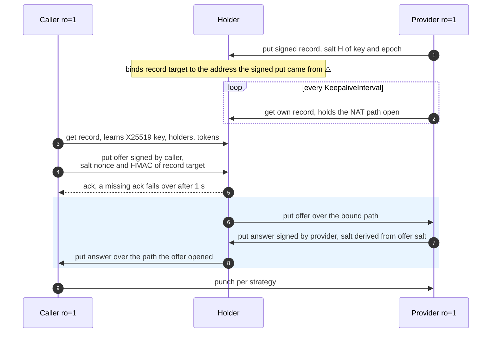

# warren (Go): Mainline-native discovery, signaling, and hole punching

A Go peer-to-peer connectivity stack that **is** a Mainline DHT node on the wire,
uses the DHT for signaling, and punches through NATs with measured, per-NAT
strategies. It borrows architecture, not wire format, from
[myleshorton/warren](https://github.com/myleshorton/warren) (Rust), whose own DHT is
deliberately incompatible with BitTorrent.

## Goals and constraints

- **Indistinguishable from BitTorrent DHT traffic**, as close to libtorrent as
  possible. Discovery runs in separate per-language community DHTs (see
  below), but every node also behaves as an ordinary Mainline node toward
  outsiders.
- **Survives national shutdowns** on the domestic internet (Iran, Russia, China).
- **DHT is the signaling plane.** There's no separate signaling service. Lantern-run
  nodes make it faster but aren't required.
- **State-of-the-art NAT traversal**, chosen per NAT from measured behavior.
- **Fits the iOS Network Extension** next to the sing-box datapath. radiance sets
  `GOMEMLIMIT=40MB` against a ~50 MB jetsam cap, and our budget target is under
  3–5 MB.

## Architecture (from Rust warren, kept)

- **Sans-IO core.** The DHT is a pure state machine that consumes datagrams and
  caller-supplied time and returns sends, events, and the next wakeup. One I/O
  goroutine drives it. Deterministic simulation and adversarial tests run against
  the same core that ships.
- **Every resource is bounded:** routing entries, candidates per lookup, in-flight
  RPCs, stored items, sockets per punch, probes per punch.
- **Admission diversity:** one identity per IP, at most 2 per /24 (or /64) per
  bucket, and 8 per prefix per table; lookups admit at most 8 candidates per
  prefix. Rust warren also tracks lookup provenance with per-origin quotas;
  that is planned here, not built.
- **Value retrieval during traversal** (BEP 44 `get` lookups return on the first
  verified value).
- **Blinded, rotating keys:** `H(key ‖ epoch)`. Providers publish the
  current epoch's record and keep the previous one until it ages out; callers
  try the current epoch, then the previous. Pre-publishing the next epoch is
  planned.

## Wire: Mainline as-is

| BEP | Use |
|---|---|
| 5 | KRPC (`krpc/`) |
| 32 | `nodes6` / `want` |
| 42 | Secure node IDs for server nodes, plus the `ip` field (our free reflector, see below) |
| 43 | `ro=1` for phones: query-only, never in routing tables, no storage |
| 44 | Signed mutable items: records and signaling |
| 51 | Planned: answer `sample_infohashes` like a normal node (today it gets `204 Method Unknown`) |

Security moves up a layer, because BEP 5 is plaintext and unauthenticated:

- **Authenticity:** BEP 44 ed25519 signatures on records.
- **Confidentiality:** encrypted BEP 44 values.
- **Unlinkability:** blinded keys.
- **Sybil and eclipse resistance:** BEP 42 plus local admission policy.

Fingerprint hygiene means matching libtorrent. `cmd/ltfingerprint` runs real
libtorrent 2.1.1 nodes next to ours on loopback and diffs every message kind:
key sets, transaction and token lengths, `v`, node counts, and `ip`. It exits
non-zero on any difference. The first run found three fingerprints, all fixed and
pinned by `TestLibtorrentWireHabits`:

- **`v` in every message.** libtorrent always sends `LT` + major +
  (minor<<4 | patch), so 2.1.1 is `LT\x02\x11`. We sent none.
- **`p` in every response:** the requester's port, alongside the top-level `ip`.
- **No `find_node`.** libtorrent builds bootstrap and refresh on `get_peers`. Our
  node-finding lookups now do the same.

Matching now covers message *shapes*. Timing (timeouts, retry cadence, refresh
intervals) is not compared yet. `natprobe` records the `v` distribution of live
responders: `LT 012f` (1.2.15) and `LT 0212` (2.1.2) are common, and about a
quarter send no `v`.

## Community overlays (language DHTs)

Deployments run separate DHTs per language community, for example Farsi, Russian,
and Chinese. A community includes people inside and outside the country, so during
an international shutdown the domestic part keeps working on the domestic internet.
Every overlay speaks unmodified libtorrent-style KRPC. Rust warren's regional design
marks overlays with a cleartext `WRO1` header plus an overlay ID, which identifies a
community passively. This design avoids that in four ways.

- **Membership in the node ID** (`overlay/`). BEP 42 fixes 21 bits plus the last
  byte. Bytes 15–18 carry a tag: the first 32 bits of SHA-256(community key ‖ rest
  of the ID). Members recognize each other from the `id` every message carries.
  There is no extra field. Without the key, IDs look like ordinary random BEP 42
  IDs. Each check takes 41 ns with zero allocations. Each community uses its own
  socket and ID.
- **Two personalities per node.** Queries from tagged IDs are answered from the
  community routing table. Everyone else gets ordinary libtorrent answers from a
  small real Mainline table (a few hundred entries, ~50 KB). Keyless active probing
  sees an ordinary BitTorrent node. During a shutdown, the domestic slice of
  Mainline keeps providing that cover.
- **Domestic copies.** Each record goes to the k closest nodes and to the k closest
  nodes inside the country's address ranges. When the border closes, foreign
  holders vanish and lookups converge on the domestic copies. This is simpler than
  Rust warren's separate IP-restricted local overlay, and it can be added later if
  measurement shows it's needed.
- **Partition detection.** When a large fraction of contacts time out together,
  switch to aggressive eviction, refresh, and republish rather than waiting out the
  normal timeouts. Persisted routing tables and invitations provide domestic
  bootstrap with no foreign dependency.
- **Isolation mode** (`dht/isolation.go`). This is a durable state: domestic
  contacts answer, and foreign ones have been silent for 3 minutes. Partition
  detection, by contrast, adapts to the new baseline within about 10 minutes.
  While isolated:
  - lookups skip foreign candidates;
  - holders re-put the community records they store, skipping a record that
    someone else already re-put this interval (as in original Kademlia);
  - remembered foreign contacts are probed every 2 minutes.

  One foreign answer ends isolation.

### Shutdown simulation (`sim/shutdown_test.go`)

Setup: a deterministic virtual network with 8 replicas, 2-hour record lifetime,
30-minute republish, and the border cut after a 75-minute warm-up. Readers are
domestic (half read-only phones, half routers). Columns are the share of
successful reads of domestically / foreign-published records.

**router-scarce:** 60 domestic routers, 180 abroad, and 200 domestic phones. 20% of
domestic routers go offline after the cut.

| After cut | plain | + domestic copies | + partition detection | + isolation mode |
|---|---|---|---|---|
| +1 min | 91 / 88 | 99 / 100 | 99 / 100 | 100 / 100 |
| +15 min | 100 / 90 | 100 / 100 | 100 / 100 | 100 / 100 |
| +2 h | 96 / 0 | 94 / 0 | 100 / 0 | 100 / 100 |
| +3 h | 84 / 0 | 80 / 0 | 82 / 0 | 100 / 100 |
| 30 min after reopening | 83 / 0 | 81 / 0 | 84 / 0 | 99 / 100 |

(An earlier version of this table came from a run whose churn schedule moved
simulated time backwards, so early rows saw later state. Departures are now
scheduled events and the simulator refuses to rewind time.)

Findings:

1. **Domestic copies fix the first hour.** Right after the cut, a record's
   replicas are known mainly to its ID-space neighbours, who are mostly dead
   foreigners. Domestic tables stay full of dead foreign entries and heal slowly.
2. **Record lifetime is the second cliff.** Records whose publisher is abroad, or
   whose domestic publisher went offline, expire 2 hours after their last put. Only
   holder re-replication keeps them alive.
3. **Plain Kademlia never re-merges after a long partition.** Each side evicts the
   other entirely, so neither table holds a cross-border contact once the border
   reopens. Neither side re-bootstraps, because its table isn't empty. In the
   balanced run, foreign-published records were still at 0% 30 minutes after
   reopening. Isolation mode's foreign probes reconnect the halves.
4. **The balanced run** (240 domestic, 80 abroad, no churn) shows only findings 2
   and 3. With mostly domestic routers, replica placement alone survives the cut.

The simulation does not model NAT, packet loss, provider-level splits inside the
country, or adversarial nodes. It shows the protocol logic is sound. Real-world
numbers still need field measurement, starting with the router-supply survey.

**The main survival risk is router supply.** Most Iranian mobile users sit behind
CGNAT and can only be read-only (`ro=1`) clients. The overlay needs enough
reachable domestic nodes: broadband, mobile IPv6, and NATs that accept unsolicited
traffic. We can measure this from outside before any shutdown: the vantage survey
asks what fraction of domestic Mainline nodes answer unsolicited pings, by ASN.

**Limit:** the key ships in the app. A censor who extracts it can check tags on
every packet. The tag defeats generic DHT fingerprinting and keyless probing. It
can't hide an open community from a censor running a per-community MAC check.

## Signaling (`dht/signal.go`)

This follows HyperDHT's design, in which the nodes holding a provider's record
relay its handshake, but every message is a standard BEP 44 `get` or `put`. In a
community overlay every node runs our code, so **record holders are the
coordinators**. The signaling path needs no Lantern infrastructure, and during a
shutdown the domestic holders keep relaying.



**Wire encoding:**
- **Record:** `k` is the provider's key, `salt = H(key ‖ hourly epoch)`, and `v` is
  `{"x": X25519 key}`. Callers try the current epoch, then the previous one.
- **Offer:** `k` is the caller's key, `salt = nonce ‖ HMAC(record target, nonce)`,
  and `v` is `ephemeral X25519 key ‖ AES-256-GCM(payload)`, with keys from
  HKDF-SHA256. A holder can match the salt against the records it binds. An
  observer can't link it to the provider without knowing the record target.
- **Answer:** `k` is the provider's key, `salt = H(offer salt)`, and `v` is
  encrypted under the answer key. The caller checks that the signer is the
  provider it called.
- **Delivery:** forwarded items arrive as `put` queries. Read-only nodes
  intercept them before ignoring queries.

**Security:**
- **Binding:** only a signed put binds or rebinds a record to an address. A
  replayed put from elsewhere can't move a binding the provider keeps fresh, and
  keepalives from other addresses don't refresh it (`TestBindingResistsReplay`).
- **Address changes:** a provider that sees its mapped address change in a
  keepalive reply re-signs with a higher sequence number, which rebinds.
- **Holder trust:** offers and answers are end to end encrypted and signed, so a
  holder can drop them but can't read or forge them.
- **Replay:** offers older than 60 seconds are rejected, and each offer salt is
  accepted once.

**Simulated latency, including the record lookup:**
- phone to phone: 824 ms;
- with the first holder dead: 1.19 s;
- an hour into a shutdown, through domestic holders: 361 ms.

The loopback UDP test completes in about 11 ms.

Two fixes came out of this work:
- **Ack-based failover.** A caller fails over after a missing ack (one round trip)
  rather than after the full 2.5-second answer window.
- **Lookups no longer wait on slow queries.** Like libtorrent, queries past the
  short timeout no longer hold a lookup open. Previously one dead node near the
  target added a full query timeout to every lookup that passed it.

**Keepalive cadence.** HyperDHT pings its relays every 3 seconds, which is far
from libtorrent's cadence and costly on phones. Our keepalive must only beat the
NAT's UDP mapping timeout. `natprobe.MappingTimeout` measures it: each idle gap
runs on its own socket, and a changed BEP 42 port means the mapping expired.
`KeepaliveFor` then picks 80% of the longest surviving gap, never below 10
seconds, defaulting to 25 seconds. Port-preserving NATs reuse the same port for a
new mapping, so they need a cooperating vantage to measure.

**Open question:** `put` queries delivered to read-only nodes. libtorrent never
queries `ro=1` nodes, so a stateful observer could notice. The alternative is to
deliver by answering the provider's own keepalive `get`, which looks normal but
adds up to one keepalive interval of latency.

## NAT traversal (`punch/`)

`punch` is a sans-IO engine like `dht`. A `Session` owns numbered virtual
sockets, takes datagrams and time, and returns sends and events. `Runner`
drives it over real UDP: it opens extra sockets on demand, closes the losing
ones, and hands back the nominated socket.

**Probes are KRPC pings.** Each side's node ID derives from a secret shared
through the encrypted signaling offer, so probes can't be forged. On the wire a
punch looks like two DHT nodes pinging each other; birthday sprays still look
like many pings to one IP. Each offer carries the side's candidates and NAT
profile: mapping type, allocation pattern, sequential step, and port block. It
encodes in under 200 bytes.

**Plan (`punch/plan.go`)** chooses from mapping and allocation, not an
open/consistent/random label:

| Local \ peer | independent | dependent |
|---|---|---|
| independent | direct simultaneous open | **spray** the peer's predicted window (sequential), its block, or the full range |
| dependent | **open** sockets toward the peer | **double birthday** when both ranges are known, otherwise relay |

**Probe authentication.** Probe IDs are static per-session values derived
from the secret, so an off-path attacker can't forge one. An on-path observer
who sees a probe could race a copy from its own address and get that address
nominated. That is accepted: an on-path attacker can already drop the
packets, and impersonation still fails, because hysteria2 pins the provider's
key and derives its password from the secret.

**Inbound punches are rate-limited** (`endpoint/limit.go`), so a forged offer
naming a victim can't turn a listener into a probe reflector:
- per caller key, checked first so one key can't spend the shared budgets;
- per probed network: public candidates by /24 (or /48), non-public ones by
  exact address;
- relays twice: by exact address, and by network in a separate, looser bucket,
  so routers sharing a /24 don't lock each other out but a victim network is
  still capped;
- global budgets, charged by the planner's actual strategy: a tight one for
  probe-heavy punches (spray, open sockets, double birthday) and a looser one
  for all punches.

Checks never write on refusal, so attempts from ever-new keys can't grow the
tables.

A responder also never sprays a non-public address. Doing so would port-scan
its own LAN or localhost on a stranger's request. LAN candidates get only
direct probes. Keys are free to mint, so a determined attacker can still
exhaust the global spray budget; `Authorize` is the defense for a listener
under attack.

**The initiator nominates** the first confirmed path. Responses are matched by
**transaction ID, not source address**, as ICE does. Under dependent mapping a
reply comes from a new port; nominating that port would mint fresh mappings on
every round trip, so the initiator keeps its probed destination.

**Port budget.** With dependent mapping, every new destination costs a NAT port.
A carrier NAT's per-subscriber quota may be only about 2,000, shared with the
VPN tunnel and everything else on the phone. The double birthday therefore
probes a fixed set of at most size/8 (and no more than 256) socket-and-port
pairs and re-sends on them. That gives about size/64 expected hits and caps the
cost of a failed attempt at about 259 ports. An earlier version drew a new port
on every round and exhausted a 2,048-port block in 3 seconds.

**Success matrix** (`punch/matrix_test.go`). This uses the RFC 4787 NAT model in
`sim/nat.go`, 40 seeds per pair. The baseline is HyperDHT-style: it knows only
consistent versus random mapping and refuses pairs where both map dependently.

| Pair | Ours | Baseline |
|---|---|---|
| public with anything, cone ↔ cone | 100% | 100% |
| cone ↔ sequential | 100% | 82% |
| cone ↔ port block | 100% | 85% |
| **carrier block (address filtering) ↔ carrier block** | **100%** | **0%** |
| cone ↔ random | 92% | 92% |
| dependent ↔ dependent with address-and-port filtering, or a random allocator | 0–2% | 0% |

Cone ↔ random matches the budget's prediction: 2,400 spray probes against 64
sockets give 1 − (1 − 64/64512)^2400 ≈ 91%. A faster spray reaches 99% at the
cost of more traffic.

In this standalone matrix the zeros have no relay. The full stack sends them
through a router relay (see *Relay fallback*). Filtering measurements would let
the planner skip doomed double birthdays, and IPv6 and port mapping (PCP/UPnP)
would avoid the relay for some of them; neither is built yet.

Times to connect in the model: 0.24–0.5 s for direct and spray, 1.6 s for
cone ↔ random, 0.28 s for the double birthday. The real-UDP runner is tested on
loopback for direct and open strategies; relay-needed pairs fail fast without
probing.

**Handoff.** Once connected, the socket belongs to the application, which
can't answer punch traffic. The responder sends its final acknowledgement
three times. On a direct path, the initiator connects after five unanswered
nominations, provided the peer already answered one of its own probes on that
pair (so the path is known to work both ways). A few stray control datagrams
can reach the application afterwards; layers above drop them, and
`endpoint.Conn.Recv` skips them.

**Still to come:** IPv6 candidates; PCP/NAT-PMP/UPnP (Tailscale's `portmapper` is
a candidate); low-TTL priming; filtering-aware planning. Check the iOS
`RLIMIT_NOFILE` soft limit before relying on 64-socket fans.

## Connecting by public key (`endpoint/`)

`Endpoint.Connect(ctx, identity, peerKey)` returns a connected UDP socket. The
provider side uses `Listen` and `Accept`.

1. Bind a fresh data socket. Learn its public address by pinging DHT contacts,
   which return the BEP 42 `ip` field.
2. Send a punch offer (candidates, NAT profile, 32-byte secret) as the signaling
   payload. The provider answers with its own candidates and profile, gathered
   on its own fresh socket.
3. Punch with the planned strategy. The winning socket is returned and the rest
   are closed.

**Authentication.** Only the provider's private key can decrypt the offer, the
answer is signed by that key, and probes carry IDs derived from the secret. So
the caller knows it reached the provider, and `Conn.PeerKey` on the provider is
the caller's verified key. `Conn.Secret` is shared only by the two ends, for
binding the coming QUIC or Noise handshake to this path.

**NAT profile.** It's inferred passively from the DHT socket's BEP 42
reflections, since the same NAT maps the data sockets, using `natprobe.Analyze`.
No probe traffic is involved. `Config.Profile` overrides it.

**Other behavior:**
- `Authorize` rejects callers with **silence** rather than a refusal, so a probe
  learns nothing beyond the public record.
- `MaxInbound` (default 8) bounds concurrent inbound punches and the sockets
  they hold.
- The signaling answer window is now 4 seconds, because providers gather before
  answering. Dead holders are still detected by the missing ack after 1 second.

Loopback tests cover connect plus data both ways (about 10 ms), three concurrent
callers, an unknown key (`ErrNoRecord`), and authorization. They are race-clean
over 10 runs.

**Full stack through modeled NATs** (`sim/fullstack_test.go`). The simulator now
puts hosts behind the RFC 4787 NAT model, with a DHT socket plus data sockets
carrying punch sessions. The test runs endpoint's exact flow between read-only
phones: gather via DHT contacts, signal, the provider gathers and answers, both
punch. It covers records bound through the provider's NAT (one binding per
holder, even under dependent mapping), keepalives holding those mappings open,
offers and answers forwarded through NATs, and passive NAT inference from DHT
reflections. Every inference was correct. Four seeds per pair:

| Provider ↔ caller | Connected | Median time* | Strategy |
|---|---|---|---|
| cone ↔ cone | 4/4 | 1.62 s | direct |
| cone ↔ carrier block | 4/4 | 1.64 s | open |
| carrier block ↔ carrier block | 4/4 | 1.65 s | double birthday |
| cone ↔ sequential | 4/4 | 1.52 s | open |
| cone ↔ random | 4/4 | 4.39 s | open |
| sequential ↔ sequential (strict filtering on both sides) | 4/4 | 4.66 s | relay, after the direct attempt |
| carrier block ↔ random | 4/4 | 1.64 s | relay, immediately |

Before the relay existed, the last two pairs connected 0/4.

\*Includes a fixed 1-second gather wait in the test. The endpoint proceeds on
the first reflection.

## Relay fallback (`dht/relay.go`, `punch/relay.go`)

Pairs with no direct path (strict filtering on both sides, or a random
allocator on a hard side) go through a **router relay drawn from the swarm**.
Lantern's own proxies may be unreachable during a shutdown, so this follows
HyperDHT's volunteer blind relays rather than depending on Lantern
infrastructure.

- **Binding is a standard `announce_peer`.** Both peers' data sockets announce
  the same secret-derived info-hash to router R (`get_peers` for a token, then
  `announce_peer` with `implied_port`). R pairs the two announcers.
- **Forwarding is blind.** R passes non-KRPC datagrams between the paired
  addresses. The payload is end-to-end encrypted hysteria2. To an observer,
  each peer announced a torrent to a DHT node and then talked uTP with it,
  which libtorrent does on the same socket.
- **The relay is negotiated.** The caller offers up to eight of its DHT
  contacts as candidates. The listener picks one and names it in its answer,
  and both sides bind it in parallel with punching, so falling back is instant.
  Relay probes are authenticated datagrams shaped like uTP `SYN`/`STATE`. Probing
  starts immediately when the plan has no direct strategy, and otherwise
  halfway to the punch deadline, so a direct path always wins. Both sides
  probe. The listener answers the caller's probe with three acks and hands
  off; if every ack is lost, the caller, having seen the listener's probes,
  connects after five unanswered probes, as on a direct path.
- **Volunteer cost is bounded.** Routers relay by default (`DisableRelay` opts
  out), with at most 16 pairs at once (`MaxRelayPairs`) and 512 KB/s per pair
  (`RelayRate`, a token bucket; packets over budget are dropped, so end-to-end
  congestion control backs off). Pairs are fixed once formed, so a third
  announcer can't join or hijack them. Idle pairs expire after a minute, and
  read-only phones never relay.
- **Admission is loose by design.** An address relays one pair. A source (an
  IPv4 address or IPv6 /64; all link-local senders share one) holds at most
  8 half-formed pairs and one pair with itself. A half-formed pair lives at
  most 30 seconds however often it is re-announced. A full table evicts a
  half-formed pair rather than refusing new ones: from the source holding
  the most, least recently active first, never one created less than two
  seconds ago, unless every pair is that young, in which case the heaviest
  source gives up its youngest to a lighter newcomer.
  So a flood churns its own entries instead of locking the table. Clients
  re-announce every second until they hear their peer through the relay, so
  a pair evicted anyway is rebuilt. Tighter per-source limits would hit CGNAT users and relay-only
  listeners as hard as attackers. So pairs between different sources are
  bounded only by the pair cap, the byte budget and idle expiry, the
  open-relay limit every volunteer relay shares.
- **Each relay-only side trusts only routers it knows.** A relay learns both
  addresses. A relay-only listener picks the first offered candidate it has
  authenticated itself, or else its own closest contact. A relay-only caller
  accepts the listener's pick only if it was one of its own candidates. Two
  relay-only peers that share no known router can't connect.
- **Relay-only privacy mode** (`endpoint.Config.RelayOnly`, `punch.Config.RelayOnly`).
  The offer carries no candidates and the peer is never probed directly, so a
  peer sees only the relay, never your IP. The relay router still sees both
  ends.

Tests: router rules (pairing, no hijack, byte budget, pair limit, opt-out),
the full-stack NAT simulation above, and a real-UDP relayed `Connect` with
hysteria2 over uTP through the relay (about 10 ms on loopback).

## Data plane: hysteria2 shaped as BitTorrent uTP (`utpshape/`, `transport/hy2/`)

Plain QUIC is blocked in several target countries, Iran included, so the
punched socket carries **hysteria2** (sing-quic, the same engine lantern-box's
hysteria2x uses). It brings Brutal congestion control for congested, censored
links, and BBR otherwise. BBR is the default between phones, because Brutal on
a mobile uplink can starve the user's own traffic.

Underneath hysteria2 sits a pluggable obfuscation layer:

- **uTP shaping (`utpshape`, the default).** Every datagram gets a real 20-byte
  BitTorrent uTP header (BEP 29): consistent connection IDs, incrementing
  sequence numbers, acks of the peer's sequence, and microsecond timestamps.
  Connections open with an empty `ST_SYN` answered by `ST_STATE`. The payload is
  AES-CTR encrypted, so it looks like encrypted (MSE) BitTorrent. The IV is the
  header's own fields, so the header is the only overhead. Wireshark's dissector
  parses every packet as uTP, with data packets shown as **BitTorrent over uTP**
  (`TestWiresharkSeesUTP`). It also matches the DHT cover exactly: libtorrent
  runs DHT and uTP on one UDP socket, so DHT pings followed by uTP on the same
  socket is ordinary BitTorrent behavior.
- **Salamander** (hysteria2's): random-looking datagrams.
- **None:** plain QUIC, for regions where QUIC passes. Outline's `quicprelude`
  and hysteria2x's `pre_initial_junk` belong here: they defeat SNI inspection
  of QUIC but leave it recognizable as QUIC.

**Speed.** Shaping costs 243 ns per 1,200-byte packet (about 4.9 GB/s on one
core). hysteria2 over loopback, which is CPU-bound:

| Mode | MB/s |
|---|---|
| plain QUIC | 166 |
| uTP-shaped | 123 |
| Salamander | 94 |

The remaining gap to plain QUIC is per-packet syscalls: a wrapped socket loses
quic-go's batched UDP paths. Recovering GSO and batching, which matters for
servers, is follow-up work. On real mobile links every mode is link-bound, and
uTP's cost is about 1.5% in header bytes.

**MTU.** `utpshape` sets Don't-Fragment on the socket (`IP_DONTFRAG` on Darwin,
`IP_MTU_DISCOVER` on Linux). QUIC's MTU discovery then measures the real path
including the 20-byte header: a probe of size S succeeds only if S+20 fits.
Without Don't-Fragment, it stays at 1,200 bytes (1,220 on the wire, inside the
IPv6 minimum MTU).

**Authentication.** The provider's TLS certificate is generated from its
ed25519 key, and the caller pins that key (an impostor fails the handshake with
`certificate is not the peer's key`). The hysteria2 password and the uTP key
derive from the session secret via `hy2.FromSecret`.

**iOS.** hysteria2's 8 MiB stream and 20 MiB connection receive windows are
capped to 1 MiB and 2.5 MiB through `QUICOptions`, with no fork needed. The
engine is already linked into the Network Extension through lantern-box.

Measured Go heap and stack growth (`TestPhoneMemory`, in-process; a device
build should confirm it):

| Phone state | Growth |
|---|---|
| read-only DHT node, bootstrapped, idle | 0.04 MiB |
| listening as a provider | 0.26 MiB |
| 64 MiB transfer behind a slow reader, capped windows, both ends | 7.6 MiB peak |
| same, hysteria2's default windows | 23.6 MiB peak |

The DHT is effectively free. The transfer cost is the receive buffer, about
3.8 MiB per end with caps versus about 12 MiB with the defaults, so **the caps
are mandatory**. They still allow about 100 Mbps at 200 ms round-trip time.

**Shaper interface.** `hy2.Shaper` (wrap a socket, declare per-packet overhead,
optionally report Don't-Fragment) separates the transport from the
obfuscation. `utpshape` is one implementation. The spec-driven shaping engine
(design in `docs/shaping-design.md`) plugs in the same way. QUIC's initial
packet size comes from the declared overhead.

**As a general transport.** `utpshape` is a plain `net.PacketConn` wrapper with
per-peer state, so one server socket serves many clients. That makes it a
candidate hysteria2 obfuscation mode for lantern-box client-to-server traffic as
well. The client side slots into hysteria2x's dialer hook, as `pre_initial_junk`
does today. The server needs a hysteria2x inbound that wraps its listener
before `Service.Start`, since a stock hysteria2 server can't unwrap uTP.

## Phase 0: measure first (`natprobe/`, built)

`natprobe` uses **public Mainline nodes as reflectors**: BEP 42 responses carry the
requester's observed address. Serial pings to fresh, /16-diverse reflectors, plus
extra local sockets, show:

- mapping behavior (with outlier tolerance);
- port preservation;
- external-IP pooling;
- allocation pattern (sequential step normalized by mapping gaps, aligned
  port-block inference, or random);
- birthday odds;
- an inbound-filtering signal from unsolicited queries.

It needs no Lantern infrastructure, and on the wire it is ordinary DHT traffic.

```sh
go run ./cmd/natprobe            # human summary
go run ./cmd/natprobe -json      # full report for telemetry
go run ./cmd/natprobe -listen 90s  # also test unsolicited inbound as a full node
```

**No client telemetry.** NAT measurements identify clients: external IP, mappings,
and carrier allocator. The design therefore splits measurement in two:

- **On device, local only.** The core runs `Analyze` passively over the `ip` fields
  of ordinary lookup responses, recording send order. The result picks the punch
  strategy and travels only inside the end-to-end encrypted offer. The standalone
  `natprobe` command stays a development tool, because its traffic pattern (serial,
  /16-diverse pings plus a socket fan-out) doesn't look like libtorrent.
- **Population, from our own vantage.** Lantern-run Mainline nodes on several IPs
  apply RFC 5780-style tests to public BitTorrent nodes behind the same carriers:
  - **Filtering:** node N queries vantage A, then we ping N from vantage B (a
    different IP) and from A's IP on another port.
  - **Mapping:** compare source ports when one node ID contacts several vantages.

  Only aggregates by country, ASN, and NAT class are stored; IPs are dropped at
  ingestion. These vantages are the signaling coordinators as well.

## Roadmap

| # | Piece | Status |
|---|---|---|
| 0 | NAT classification and router supply | `natprobe/` built and validated live. `survey/` and `cmd/survey` built: cold reachability and other-port filtering per region, counters only. A first live run found 75% of 307 referred nodes globally answered a cold ping. Next: long runs on a server with region CIDR lists, a second vantage IP for address-filtering tests, and moving NAT classification into the core as a passive observer |
| 1 | Bounded bencode + KRPC (BEP 5/32/42/43/44) | `bencode/`, `krpc/` built, fuzzed, matching spec vectors |
| 1b | Community membership tags | `overlay/` built |
| 2 | Sans-IO DHT core and deterministic simulator | `dht/`, `sim/` built: two personalities, BEP 42/43/44 (immutable and mutable, matching spec vectors, CAS and seq rules), domestic copies, partition detection, isolation mode, snapshots and `Rejoin`. Regression tests cover idle traffic, determinism, and mutable records surviving shutdown |
| 2b | UDP driver | `driver/` built: one goroutine owns the node. Loopback tests cover put/get, mutable, a read-only phone, restart from snapshot with no bootstrap server, and Close unblocking callers. Race-clean over 20 runs. IPv4 only for now |
| 2c | libtorrent wire matching | `cmd/ltfingerprint` built; 0 shape differences against 2.1.1. Next: timing comparison, and `announce_peer`'s `seed` flag once we announce |
| 3 | Signaling over BEP 44 | `dht/signal.go` built: provider records on hourly blinded salts, holder binding and forwarding, encrypted offer and answer, ack-based failover; exposed through `driver`. Simulation tests cover phone to phone, a dead holder, a shutdown, and an unknown provider. Mapping-timeout probe built. Next: keepalive-answer delivery as an option, and a store-and-poll fallback |
| 4 | Punch engine | `punch/` built: sans-IO session, planner, real-UDP runner, `sim/nat.go` RFC 4787 model. Success matrix above, with a port-quota budget. Next: IPv6, port mapping, filtering-aware planning |
| 4b | Connect by public key | `endpoint/` built: signaling plus punch, a passive NAT profile, authorization, and bounded inbound. Full-stack simulation through modeled NATs passes |
| 4c | Relay fallback | Router relays via `announce_peer` binding and blind forwarding with volunteer limits, plus relay-only privacy mode. Every simulated NAT pairing connects |
| 5a | Configurable shaping (glamour) | Design only, in `docs/shaping-design.md`: a spec-driven engine at `github.com/getlantern/glamour`, implementing `hy2.Shaper`. Not built yet; to be built in a separate session |
| 5 | Data plane | `utpshape/` (uTP-shaped obfuscation, Wireshark-verified, Don't-Fragment-aware) and `transport/hy2/` (hysteria2 over the punched socket, key-pinned TLS, password from the secret, iOS windows) built. End to end: `Connect`, then hysteria2 over uTP, then streams. Next: batched UDP I/O for servers, a lantern-box hysteria2x inbound and outbound for uTP mode |
| 6 | iOS integration, memory budget, network-change rebind | |
