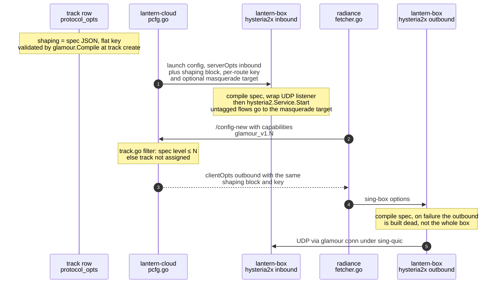

# glamour: declarative packet shaping for QUIC transports

Status: design draft, nothing built. Audience: Lantern engineers working on
lantern-box, lantern-cloud, radiance and warren.

## 1. Summary

Lantern has five pieces of code that change what QUIC looks like on the wire.
Each is a separate one-off:

| Mechanism | Where | What it does | Server |
|---|---|---|---|
| `utpshape` | `warren/utpshape/utpshape.go` | 20-byte BitTorrent uTP header, SYN→STATE handshake, AES-CTR payload with the header as IV | must unwrap |
| `pre_initial_junk` | `lantern-box/protocol/hysteria2x/outbound.go:139` | one random 8–64 byte datagram on each new UDP flow, before the Initial | stock |
| `quicprelude` | `outline-sdk/x/quicprelude` | invalid Initial-shaped datagram before each packet that may carry a ClientHello | stock |
| Salamander | `sing-quic/hysteria2/salamander.go` | 8-byte random salt, BLAKE2b-derived XOR | stock (sing-quic native) |
| Gecko | `sing-quic/hysteria2/gecko.go` | splits long-header packets into 2–8 padded fragments, then Salamander | stock (sing-quic native) |

All five do the same few things. They inject datagrams on a trigger. They
prepend a header built from a few field kinds. They transform the payload with
a keystream. They pad or fragment to a size distribution. A few keep a small
handshake state machine.

**Proposal.** Build one engine, `glamour`, that does all of this, and drive it
from a versioned JSON spec. It is a standalone Go module,
`github.com/getlantern/glamour`, so warren, lantern-box and lantern-cloud can
all import it without warren depending on lantern-box. A spec compiles once
into an immutable `Program`. Running a packet through it walks a fixed list of
ops with no allocation. The engine is a `net.PacketConn`/`net.Conn` wrapper, so
it plugs in where `utpshape` and `junkDialer` plug in today, and it implements
warren's `hy2.Shaper` interface. A track carries its spec as a new flat
`shaping` key in `protocol_opts`. lantern-cloud validates the spec with the
same compiler the clients run, injects it into both the client outbound and the
server inbound, and only assigns the track to clients that advertise a high
enough `glamour_v1.N` capability. A client that cannot compile a spec loses
that track; it never falls back to unshaped hysteria2.

The spec is data, not code. Every spec has bounded overhead, bounded injected
bytes, and bounded server state, and no spec can make the engine itself send
more bytes than it received. All of that is checked when the spec compiles.
That is the main reason to prefer a declarative spec over WASM (WATER) or a
general bytecode VM (§12). Datagrams that fail authentication on a server are
forwarded to a configured masquerade site when there is one, so active probes
see a real server's replies (§5.1).

## Handoff: starting the glamour work

For an engineer or AI session picking this up cold.

**Decisions already made**

1. The engine is named `glamour` (the spell that makes one thing look like
   another, which is what the engine does to QUIC). Module
   `github.com/getlantern/glamour`, package `glamour`, client capability
   `glamour_v1.N`. It depends only on the standard library, x/crypto and x/sys.
2. Unauthenticated datagrams on `engine`-class servers are forwarded to the
   track's masquerade endpoint when one is configured, with the target's
   replies relayed back; with none configured the server stays silent. Warren
   P2P keeps answering like a real uTP stack (§5.1).
3. A client that cannot compile a track's spec loses the track entirely. The
   outbound is built dead rather than erroring, so sing-box still starts.
   lantern-cloud compiles every spec with the same code before assigning it,
   and only assigns it to clients whose `glamour_v1.N` covers the spec's level
   (§5).
4. The quic-go hook for restoring GSO and batched reads is **still open**:
   upstream to sagernet/quic-go or carry a getlantern fork (§9.3, §15).

**Open questions** (§15): the quic-go hook, whether the masquerade is
indistinguishable, relay latency, target selection and rotation, TCP 443
consistency, the quicprelude VN problem, `ip_ttl` calibration, key handling.

**Read first**

- warren `utpshape/` (the uTP framing, `df_*.go` for Don't-Fragment) and
  `transport/hy2/hy2.go`. Its `Shaper` interface (`Wrap(pc, key)
  net.PacketConn`, `Overhead() int`) and the optional `DontFragmenter` are what
  glamour must implement so warren can adopt it by setting `Options.Shaper`.
- lantern-box `protocol/hysteria2x/` (`outbound.go`, `junkDialer`,
  `junk_test.go`).
- outline-sdk `x/quicprelude` on `origin/main` (`initial.go`,
  `mayCarryClientHello`, `invalidInitial`).
- sing-quic `hysteria2/salamander.go` and `hysteria2/gecko.go`, plus
  `service.go:158-175` (obfs wrapping and the VN/stateless-reset switch).

**Measured facts**

- Loopback hysteria2 throughput, one connection: plain 200 MB/s, uTP-shaped
  124 MB/s, Salamander 109 MB/s (§9.1).
- utpshape costs 243 ns per 1200-byte packet; the rest of the gap is lost
  syscall batching, not shaping.
- The sagernet quic-go fork assumes Don't-Fragment on any wrapped socket that
  doesn't expose `syscall.Conn`, and keeps PMTUD on. A wrapper must set DF on
  the underlying socket, or MTU discovery must be disabled. warren fixed this
  in `transport/hy2` (`DontFragmenter`, §6).

**First steps (phase 1, §16)**

1. Create the module with `Parse` (strict JSON), `Compile`, the built-in caps
   (§5), the canonical-JSON hash and `Level()`.
2. Build the sans-IO `Flow` and the injection family: the prelude triggers and
   the `random`, `hex`, `template` and `quic_invalid_initial` content kinds.
   Add `WrapConn`, and a `Shaper` adapter matching `hy2.Shaper`.
3. Port `pre_initial_junk` (§4.1) and the quicprelude default (§4.2) as specs
   with golden tests against `junk_test.go` and outline-sdk's vectors. Fuzz
   `Parse`/`Compile`, and assert `AllocsPerRun == 0`.
4. Add the `shaping` field to the lantern-box `hysteria2x` outbound, with
   `pre_initial_junk: true` as sugar and the dead-outbound behaviour on compile
   failure (§8.1).

## 2. Model

QUIC hands the engine one datagram at a time. The engine sends zero or more
datagrams on the wire for each one, and on the receive side undoes the
transformation. There are two families:

- **Injection (client-only).** QUIC datagrams go out byte-for-byte unchanged.
  Extra datagrams go out around them: preludes, junk, decoys and keepalives. A
  stock server drops the extras, so these specs work against any hysteria2
  server. This covers `pre_initial_junk` and `quicprelude`.
- **Framing (two-sided).** Each QUIC datagram is rewritten: a header is added,
  the payload is transformed, the datagram is padded or fragmented, and a small
  handshake may run. The far end must run the same spec to undo it. This covers
  `utpshape`, Salamander and Gecko.

That split is a little too coarse. Salamander and Gecko are two-sided, yet a
stock hysteria2 server undoes them, because sing-quic has them built in. The
compiler therefore puts every spec into one of three classes, and the class
decides how lantern-cloud configures the server:

| Class | Server config | Example |
|---|---|---|
| `client_only` | stock `hysteria2` inbound | junk, quicprelude |
| `stock_compatible` | stock `hysteria2` inbound with native `obfs` | Salamander, Gecko |
| `engine` | new `hysteria2x` inbound running the same spec | utpshape, new framings |

A spec can use both families at once. Framing changes the QUIC datagrams, and
injection adds new datagrams around them. In §4.6 the WebRTC example does both.

On the client the engine sits under sing-quic's own obfuscation, because
`dialFunc` (`sing-quic/hysteria2/client.go:257-276`) wraps whatever the dialer
returns. On the server the order is the same, because `Service.Start`
(`service.go:158`) wraps whatever it is given. So the stack on the wire is
QUIC → sing-quic obfs (if any) → glamour → UDP. Preludes therefore go out outside
Salamander, which is what we want.

## 3. Spec format (v1)

A spec is one JSON object. Top-level keys:

```jsonc
{
  "shaping": 1,              // major version; required; a client rejects any other value
  "name": "utp-bt",          // a label for logs and metrics, not an identity
  "key": { "kdf": "hkdf-sha256", "info": "glamour/utp-bt" },  // only for specs with keyed ops
  "outer": "utp",            // quic | dtls | utp | opaque: what the wire claims to be (§5.1)
  "prelude": [ /* injection rules, §3.1 */ ],
  "framing": { "stages": [ /* inner → outer, §3.2 */ ] },
  "limits":  { /* optional, may only tighten the built-in caps in §5 */ },
  "expect":  { "overhead": 20, "class": "engine" }   // optional, checked by the compiler
}
```

A spec is identified by the SHA-256 of its canonical JSON (sorted keys, no
whitespace). The bandit uses that hash as the arm ID (§14).

**Overhead is computed, not declared.** You suggested specs declare their
overhead. If a spec could declare it, the declared number would drift from
what the stages actually add. Instead the compiler computes the worst-case
overhead per datagram from the stages. `expect.overhead` is an optional
assertion that fails compilation if it is wrong. It costs nothing and catches
mistakes in review.

### Distributions

Anywhere a count, size or duration appears, any of these forms is accepted:

```jsonc
7                                         // fixed
{ "uniform": [8, 64] }                    // inclusive integer range
{ "choice": [[100, 3], [1200, 1]] }       // weighted values
{ "normal": { "mean": 900, "sd": 150, "min": 600, "max": 1200 } }  // clamped
"match_next"                              // size only: length of the packet this precedes
```

`"resample"` is a sibling key, either `"per_packet"` (the default) or
`"per_flow"`. With `per_flow`, a value is drawn once when the flow starts and
reused. Real applications are often consistent within a flow, and sampling
afresh every time is itself a pattern a classifier can spot.

### 3.1 Prelude rules (injection)

```jsonc
{
  "when": "flow_start",          // or "client_hello", {"every_packets": D}, {"after_idle_ms": D},
                                 //    {"periodic_ms": D, "while_active_ms": 30000}
  "count": 1,                    // datagrams per trigger, ≤ 16
  "gap_ms": 0,                   // delay between datagrams and before the real packet
  "size": { "uniform": [8, 64] },
  "content": { "random": {} },
  "set": [ { "byte": 0, "or": 128 } ]   // optional bit edits applied after content
}
```

Triggers:

- `flow_start`: before the first datagram on a new socket. sing-quic opens a
  new socket on every port hop, so each hop gets one too (this is how
  `pre_initial_junk` behaves today).
- `client_hello`: before any datagram that `mayCarryClientHello` accepts. That
  is quicprelude's header-only test (`initial.go`), ported as-is: at least 1200
  bytes, a known version, an Initial, and not coalesced with a Handshake
  packet.
- `every_packets`, `after_idle_ms`: the second one re-primes a middlebox that
  has forgotten the flow, for example after a NAT or classifier timeout.
- `periodic_ms`: sent from the engine's shared timer, never from the write
  path. It only runs while the flow has carried traffic within
  `while_active_ms`.

Content kinds:

| Kind | Notes |
|---|---|
| `random` | random bytes of length `size` |
| `hex` | fixed bytes; `size` must be absent or equal to their length |
| `template` | the same field list headers use (§3.2); bytes after the fields are random |
| `quic_invalid_initial` | `{version: "reserved_random"\|"draft_random"\|"0x6b3343cf", dcid_len, scid_len}`; port of `invalidInitial` |
| `dns_query` | `{names: [...], qtype}`; natural size, so `size` must be absent |
| `stun_binding_request` | RFC 5389 header, magic cookie, random transaction ID |
| `utp_syn` | 20-byte BEP 29 ST_SYN with random IDs |

`ip_ttl` is planned for v1.1, not v1: a low TTL lets a datagram reach the
censor and die before it reaches the server. It needs a per-write cmsg on Linux.
On Darwin it needs a setsockopt toggle held under the write lock. It also needs
per-path calibration, which we don't have yet (§15).

### 3.2 Framing stages

`framing.stages` is an ordered list from inner (next to QUIC) to outer (the
wire). There are four stage kinds: `header`, `pad`, `fragment`, `cipher`. Each
stage has an exact inverse, and decoding runs the stages in reverse order.

**Header fields.** A field is either `bytes: n` (1–8) or `bits: n`. Bit fields
must pack into whole bytes. Integers are big-endian unless the field sets
`"le": true`.

| `kind` | Encode | Decode |
|---|---|---|
| `const` | `value` | must equal `value`, or the datagram is dropped |
| `message` | value of the message type being sent (see `messages`) | dispatches on the value |
| `random` | per-flow PRNG | ignored |
| `counter` | `start: zero\|random\|n`, `step`, `advance: on_send\|per_message`; per peer | stored as peer state |
| `timestamp` | `unit: us\|ms\|s`, `epoch: engine_start\|unix`, truncated to width | stored |
| `echo` | last value of field `of` received from this peer (uTP `ack`) | stored |
| `echo_delta` | now − last received value of `of` (uTP `timestamp_diff`) | ignored |
| `conn_id` | per-peer ID, rules in `conn_id` | must match peer state once it is established |
| `length` | `of: payload\|padding\|datagram`, `adjust` | bounds-checked; drop on mismatch |
| `fragment_index`, `fragment_count` | set by the enclosing `fragment` stage | used for reassembly |
| `tag` | truncated keyed PRF (SipHash-2-4) over the rest of the datagram | checked before any state is allocated; drop on mismatch |

`tag` is the only field that authenticates anything, so it is what decides
whether a datagram from an unknown sender is served, forwarded to a masquerade
site, or ignored (§5.1). Mimicry and probe resistance pull in opposite
directions here: a real uTP stack answers any SYN, while a tagged spec can
tell a client from a prober.

**`cipher` stage.** It encrypts the bytes after the headers of earlier stages.

```jsonc
{ "cipher": "aes-256-ctr", "iv": { "header_bytes": [2, 18] } }      // utpshape
{ "cipher": "blake2b256-xor", "salt": "salt" }                      // Salamander: key = BLAKE2b-256(key ‖ salt), repeated
{ "cipher": "chacha20", "nonce": ["seq", "ts"], "nonce_pad": "key" }
```

The compiler requires the IV or nonce to include a `counter`, `timestamp` or
`random` field that changes on every packet and has at least 32 bits of
entropy in total. Otherwise the spec is rejected. The QUIC payload is already
encrypted and authenticated, so keystream reuse wouldn't expose user data. It
would expose the XOR of two QUIC headers, though, and that is a fingerprint.

**`pad` stage.** `{"wire_size": D, "fill": "random", "length_field": "pad_len",
"after": "header"}`. Size targets are always **on-wire** sizes. The compiler
subtracts the overhead of the stages outside this one (Gecko's 512–1200 target
already includes Salamander's 8 bytes; see `randomPadLen`). Padding never
pushes a datagram beyond what the path can carry (§6).

**`fragment` stage.** It splits a datagram that matches `select` into `count`
pieces. Each piece carries the stage's own header, optional padding and a
chunk. Reassembly is bounded by `reassembly.{ttl_ms, max_per_peer,
max_total}` and by the global byte budget.

**`messages` and `handshake`** (only on the outermost `header` stage). These
define the control datagrams and a tiny state machine with no loops. The
`initiator` list says what to send before the first data packet. The
`responder` list maps a received message to at most one reply. That rule is the
basis of the no-amplification guarantee in §5.

## 4. The five existing mechanisms as specs

### 4.1 `pre_initial_junk`

```json
{
  "shaping": 1, "name": "pre-initial-junk",
  "prelude": [{
    "when": "flow_start", "count": 1,
    "size": { "uniform": [8, 64] },
    "content": { "random": {} },
    "set": [{ "byte": 0, "or": 128 }]
  }]
}
```

The long-header bit together with a length under 1200 is what keeps quic-go
from answering. It drops long-header packets of an unknown version under 1200
bytes before it considers Version Negotiation (comment at
`outbound.go:164-167`).

### 4.2 quicprelude default

```json
{
  "shaping": 1, "name": "quicprelude-default",
  "prelude": [{
    "when": "client_hello", "count": 1,
    "size": "match_next", "size_fallback": 1280,
    "content": { "quic_invalid_initial": { "version": "reserved_random", "dcid_len": 8, "scid_len": 8 } }
  }]
}
```

**Finding: this default is not safe against a stock hysteria2 server.** The
prelude is at least 1200 bytes and has an unknown version. lantern-box's own
control test, `TestStockServerNeverAnswersJunk` (`junk_test.go:37`), confirms
that a stock hysteria2 inbound answers exactly that kind of packet with a
Version Negotiation. The censor then sees a recognizable QUIC server datagram
on a flow that was meant to open with unparseable bytes. The compiler should
warn whenever a `client_only` spec emits a long-header prelude of 1200 bytes or
more. To use this default anyway, there are two ways out:

- Run the server as an `engine` inbound, which drops preludes before quic-go
  sees them.
- Get sing-quic to set `DisableVersionNegotiationPackets` for us (§8.2).

Outline's measurements found the technique effective. The issue is the reply
from the server, not the prelude itself.

### 4.3 Salamander-compatible

```json
{
  "shaping": 1, "name": "salamander-compat",
  "key": { "kdf": "raw" },
  "framing": { "stages": [
    { "header": [{ "name": "salt", "bytes": 8, "kind": "random" }] },
    { "cipher": "blake2b256-xor", "salt": "salt" }
  ]},
  "expect": { "overhead": 8, "class": "stock_compatible" }
}
```

The output is byte-identical to `SalamanderPacketConn`, and a golden test
checks this. There is one deliberate difference. Salamander passes datagrams
of 8 bytes or fewer up to QUIC untouched (`salamander.go`, `n <= saltLen`),
while glamour drops them. In production, stock-compatible tracks should keep
using sing-quic's native `obfs`, because it already has a vectorised write
path. The spec exists to prove the model can express Salamander, and so
preludes can combine with it.

### 4.4 Gecko-compatible

```json
{
  "shaping": 1, "name": "gecko-compat",
  "key": { "kdf": "raw" },
  "framing": { "stages": [
    { "fragment": {
        "select": { "byte": 0, "mask": 128, "equals": 128 },
        "count": { "uniform": [2, 8] },
        "header": [
          { "name": "flag",    "bytes": 1, "kind": "const", "value": 128 },
          { "name": "msg_id",  "bytes": 1, "kind": "counter", "start": "zero", "advance": "per_message" },
          { "name": "idx",     "bits": 4,  "kind": "fragment_index" },
          { "name": "total",   "bits": 4,  "kind": "fragment_count" },
          { "name": "pad_len", "bytes": 2, "kind": "length", "of": "padding" }
        ],
        "pad": { "wire_size": { "uniform": [512, 1200] }, "fill": "random", "after": "header" },
        "reassembly": { "ttl_ms": 8000, "max_per_peer": 8, "max_total": 4096 }
    }},
    { "header": [{ "name": "salt", "bytes": 8, "kind": "random" }] },
    { "cipher": "blake2b256-xor", "salt": "salt" }
  ]}
}
```

Short-header packets don't match `select` and go through only the Salamander
stages, exactly as in `GeckoPacketConn.WriteTo`. The bandit can now vary
`wire_size` and `count`, which it can't do through sing-quic's two integers.

### 4.5 `utpshape`

```json
{
  "shaping": 1, "name": "utp-bt",
  "key": { "kdf": "sha256-prefix", "info": "warren/utpshape/v1 " },
  "framing": { "stages": [
    { "header": [
        { "name": "type",    "bits": 4,  "kind": "message" },
        { "name": "ver",     "bits": 4,  "kind": "const", "value": 1 },
        { "name": "ext",     "bytes": 1, "kind": "const", "value": 0 },
        { "name": "conn_id", "bytes": 2, "kind": "conn_id" },
        { "name": "ts",      "bytes": 4, "kind": "timestamp", "unit": "us", "epoch": "engine_start" },
        { "name": "ts_diff", "bytes": 4, "kind": "echo_delta", "of": "ts" },
        { "name": "wnd",     "bytes": 4, "kind": "const", "value": 1048576 },
        { "name": "seq",     "bytes": 2, "kind": "counter", "start": "random", "advance": "on_send" },
        { "name": "ack",     "bytes": 2, "kind": "echo", "of": "seq" }
      ],
      "messages": {
        "data":  { "value": 0, "payload": true },
        "state": { "value": 2, "payload": false },
        "syn":   { "value": 4, "payload": false, "conn_id": "recv" }
      },
      "conn_id": { "initiator_recv": "random", "send": "recv+1", "responder_send": "peer_conn_id" },
      "handshake": {
        "initiator": [{ "send": "syn", "before": "first_data" }],
        "responder": [{ "on": "syn", "reply": "state" }],
        "adopt_on": "data"
      },
      "unauthenticated_replies": "mimic"
    },
    { "cipher": "aes-256-ctr", "iv": { "header_bytes": [2, 18] } }
  ]},
  "expect": { "overhead": 20, "class": "engine" }
}
```

With a fixed seed and clock, this must produce bytes identical to
`utpshape.Conn`. It must also pass `TestBEP29Conversation`,
`TestSurvivesLostSyn` and `TestWiresharkSeesUTP` unchanged. `adopt_on: data`
is utpshape's recovery path when a SYN is lost.

This spec has no `tag`, so any structurally valid SYN draws a STATE: fine for
warren P2P, where that is the cover. A VPS variant would add a 4-byte `tag` in
place of the constant `wnd` field and set `unauthenticated_replies: "silent"`;
uTP has no masquerade target (§5.1).

### 4.6 New: WebRTC-style cover (both families)

WebRTC carries STUN, DTLS and SRTP on one 5-tuple and tells them apart by the
first byte (RFC 7983). This spec sends a STUN Binding Request first and as a
keepalive, and frames QUIC as DTLS 1.2 `application_data` records:

```json
{
  "shaping": 1, "name": "webrtc-dtls",
  "key": { "kdf": "hkdf-sha256", "info": "glamour/webrtc-dtls" },
  "prelude": [
    { "when": "flow_start", "count": { "uniform": [1, 2] }, "gap_ms": { "uniform": [5, 30] },
      "content": { "stun_binding_request": {} } },
    { "when": { "periodic_ms": { "uniform": [15000, 25000] }, "while_active_ms": 60000 },
      "count": 1, "content": { "stun_binding_request": {} } }
  ],
  "framing": { "stages": [
    { "pad": { "wire_size": { "choice": [[0, 6], [1100, 3], [1200, 1]] }, "fill": "random",
               "length_field": "pad_len", "after": "header" },
      "header": [{ "name": "pad_len", "bytes": 2, "kind": "length", "of": "padding" }] },
    { "header": [
        { "name": "ctype",   "bytes": 1, "kind": "const", "value": 23 },
        { "name": "version", "bytes": 2, "kind": "const", "value": 65277 },
        { "name": "epoch",   "bytes": 2, "kind": "const", "value": 1 },
        { "name": "seq",     "bytes": 6, "kind": "counter", "start": "random", "advance": "on_send" },
        { "name": "len",     "bytes": 2, "kind": "length", "of": "payload" }
    ]},
    { "cipher": "aes-256-ctr", "iv": { "header_bytes": [3, 11] }, "iv_pad": "key" }
  ]},
  "expect": { "overhead": 15, "class": "engine" }
}
```

Here `0` in `wire_size` means "don't pad". Known gap: there is no DTLS
handshake, so a classifier that tracks DTLS state would flag `application_data`
records with no handshake before them. A v1.1 `handshake` could replay fixed
ClientHello and ServerHello templates. That is safe only if the responder side
is tag-gated (§5.1), since otherwise the server answers unauthenticated
ClientHellos.

## 5. Safety

**Built-in caps.** These are compiled in. A spec's `limits` may tighten them
but never loosen them.

| Limit | Value | Why |
|---|---|---|
| Spec JSON size / fields / stages / prelude rules | 16 KiB / 32 / 4 / 8 | keeps the parser and compiler cheap |
| Prelude datagrams per trigger | 16 | quicprelude `MaxRepeat` |
| Prelude datagrams / bytes per flow | 64 / 64 KiB | stops a bad spec from becoming a flood |
| Blocking `gap_ms` per write, total | 200 ms | it stalls quic-go's send loop |
| `periodic_ms` minimum | 1000 ms | battery and radio (§10) |
| Header bytes / total overhead | 64 / 64 (warn above 32) | IPv6 minimum MTU (§6) |
| Wire datagram | 2048 | matches sing-quic `geckoMaxOnWireSize` |
| Fragments per packet | 8 | Gecko's limit |
| Reassembly bytes | 1 MiB server, 64 KiB client | GOMEMLIMIT |
| Peers per server socket | 4096 (server config may raise this to 65536) | utpshape `maxPeers` |
| Replies | ≤ 1 per received datagram, ≤ its length, 10/s per source IP | no amplification |

**No amplification or reflection.** The only server-originated datagrams the
engine creates are `responder` replies. The compiler checks that each reply is
no larger than the smallest datagram that can trigger it: uTP's STATE (20 B)
answers a SYN (20 B), a ratio of 1.0. At run time a per-source token bucket
bounds the rate. Specs that use `unauthenticated_replies: "mimic"` still
answer anyone, as a real uTP stack would. That makes them a scanning oracle
(any SYN to the port draws a STATE), though not an amplifier. Masquerade
forwarding (§5.1) is the one path where a server relays bytes it did not
create; it has its own budgets, and it adds no amplification beyond what the
target itself would send.

**State only after validation.** A server allocates peer state, a reassembly
slot or a reply only after the datagram passes these checks: `const` fields
match, lengths are in bounds, and the `tag` verifies if the spec has one.
utpshape today creates state for any datagram with the right version nibble
(`peer()` runs before any check). Peer state is a fixed-size struct of 128
bytes or less, so 4096 peers cost about 0.5 MiB. When the table is full, the
least recently used peer is evicted. The table is sharded by peer hash rather
than sitting behind one mutex: utpshape's single `c.mu`
(`utpshape.go:172,224`) is a contention point when one server socket carries
thousands of flows.

**Malformed input is dropped silently.** On a served flow, or on any flow
when no masquerade is configured, the engine logs nothing per packet and never
sends an error to the peer. Only counters change (§14).

**A client that can't compile a track's spec loses that track entirely.** This
holds for every class. There is no fallback to plain hysteria2, because an
unshaped flow is worse than no flow:

- For `engine` specs the connection can't work anyway.
- For `client_only` and `stock_compatible` specs, sending plain hysteria2 where
  the track was meant to evade inspection gets the flow blocked, and may flag
  the server IP for every other user of it.

The scope matters. sing-box fails the whole `box.New` if any outbound
constructor returns an error, which would take down every track, not just the
broken one. So `hysteria2x.NewOutbound` must not return the compile error. It
builds a dead outbound whose `DialContext` and `ListenPacket` always return
that error, and urltest and the selector route around it. The outbound never
dials unshaped.

lantern-cloud keeps broken specs from reaching anyone. It runs
`glamour.Compile` (the same code the clients and VPSes run) when a track or
experiment is created or mutated, and rejects the change on error, so a broken
spec never reaches a VPS. At assignment it gives a track only to clients whose
advertised `glamour_v1.N` is at least `Program.Level()` (§8.4). A client-side
compile failure should therefore only happen through a bug or skew, and the
dead outbound makes it visible in the client's outbound health.

### 5.1 Unauthenticated datagrams and masquerade

An active prober sends datagrams to a server port and watches the reply. A
port that answers nothing is unremarkable but uninformative, a port that
answers a uTP SYN on 443 is odd, and a port that answers exactly like a real
HTTP/3 site is the best cover. So `engine`-class servers pick one of three
behaviours for datagrams that fail authentication:

| Where | Configured | Behaviour |
|---|---|---|
| VPS inbound | `masquerade` endpoint set | forward the flow to the target and relay its replies back |
| VPS inbound | no masquerade | silence (drop); `mimic` only if the inbound opts in |
| warren P2P | always | `mimic`: answer like a real uTP stack, as a BitTorrent peer would |

This is hysteria2's HTTP/3 masquerade and REALITY's forwarding moved down to
the datagram layer: glamour forwards before QUIC sees anything, so the prober
completes a handshake with the real site and gets its certificate.

**Classification.** The server keeps a flow table keyed by the client's
address and port. The first datagram of an unknown flow goes through the
compiled spec's decode path: `const` fields, lengths, message dispatch and the
`tag`. If it decodes, the flow is pinned to **serve** and handed to the peer
table. If it doesn't, the flow is pinned to **forward**. A flow is classified
once. A forwarded flow is never promoted to served when a valid datagram later
arrives on it, and a served flow is never demoted; it is dropped and
re-classified only after its idle timeout. Switching mid-flow would let a
prober learn which datagrams the spec accepts. A legitimate client loses
nothing, because it opens a new source port (sing-quic does on every hop) and
its first datagram classifies correctly. Compiler rules make the decision
sound:

- The spec must carry a `tag` on every datagram. Without one, a prober that
  copies a header verbatim is served, QUIC silently drops the garbage, and
  the difference between "silence" and "real-site reply" becomes an oracle.
- Preludes must be tagged too (`template` content with a `tag` field). A
  random-content prelude can't be told from a probe, and as the first datagram
  it would pin the client's own flow to forward. Specs with untagged preludes
  can't be used with masquerade.

**Data path.** Each forwarded flow gets its own connected UDP socket to the
target, from an ephemeral port. The kernel demuxes the target's replies per
flow and the target sees what looks like a client behind NAT. The relay writes
replies back through the listening socket to the client's address. A shared
upstream socket demuxed by QUIC connection IDs would save fds, but it ties the
relay to parsing the outer protocol, so v1 uses per-flow sockets and bounds
them:

| Limit | Default | Why |
|---|---|---|
| Forwarded flows per inbound | 1024 | one fd and one reader goroutine each, ~10 MiB total |
| Forwarded flows per source /24 (v4) or /56 (v6) | 8 | one prober can't take the table |
| Idle timeout / hard lifetime | 30 s / 5 min | matches typical HTTP/3 idle timeouts |
| New forwarded flows per source | 2/s, burst 8 | rate-limits scanning |
| Forwarded bytes, all flows | 4 Mbit/s each way | masquerade never eats proxy capacity |

The inbound checks at startup that `RLIMIT_NOFILE` covers the cap. A full
table evicts the least recently active forwarded flow, never a served one.
Over a limit, datagrams are dropped, as an overloaded real server would.

**Abuse and safety.** UDP sources can be spoofed, so the relay must not
become a reflector toward a spoofed victim or a flood toward the target:

- **Byte budget before return routability.** Until a flow proves the client
  can receive at its address, the relay sends the client at most k times the
  bytes it has received from it, default k = 3, never more. A QUIC target
  already holds itself to 3× before address validation (RFC 9000 §8.1), but
  that limit counts bytes from the relay's address; the relay enforces it
  again toward the real client so it adds nothing on top. A smaller k is safer
  but truncates the target's first flight and is itself a distinguisher. For
  `quic` outer specs the flow is validated when the client sends a datagram
  whose Destination Connection ID matches a connection ID the target issued in
  a relayed reply. The relay reads that from the version-independent long
  header (RFC 8999), which a spoofer never sees.
- **Rate limits.** The per-source flow and rate limits and the global
  bandwidth cap above apply to both directions.
- **Only the configured target.** The destination comes from inbound config
  and is resolved by the server, never taken from packet contents such as an
  SNI. The inbound refuses targets that resolve to loopback, private,
  link-local or the server's own addresses.

**Choosing a target.** The target must speak the outer protocol the spec puts
on the wire, or the masquerade gives itself away:

- `quic`: a real HTTP/3 site on UDP 443 that accepts QUIC v1. It should be
  operated by someone who tolerates the traffic (a large CDN), and ideally
  hosted near the VPS so the relay hop adds little latency.
- `dtls`: there is no obvious public target in v1 (a TURN-over-DTLS server is
  a candidate for later).
- `utp` and `opaque`: no natural target. A random port 443 host doesn't run a
  uTP stack. These specs use silence on VPSes, or `mimic` if the inbound opts
  in and accepts being a scanning oracle.

The compiler enforces this. `Program.Masquerade()` reports whether masquerade
is allowed: the outer protocol must be `quic`, every datagram and prelude must
be tagged, and the class must be `engine`. lantern-cloud rejects a track that
sets a masquerade endpoint for a spec where it isn't allowed. The compiler
also checks that the declared `outer` matches the outermost header's leading
bits (for `quic`, the long/short header form and fixed bit), so a spec can't
claim QUIC while emitting something else.

The target is deployment config, not part of the spec. Rotating targets
doesn't change the spec hash, and so doesn't create a new bandit arm.

## 6. MTU and overhead accounting

A path at the IPv6 minimum MTU carries 1280 − 40 − 8 = **1232** bytes of UDP
payload. QUIC requires client Initials to be at least **1200** bytes. A framing
spec adds overhead O to every datagram, the Initial included, so it is safe at
the IPv6 minimum only if O ≤ 32. utpshape (20), Salamander (8) and the WebRTC
spec (15) fit. Injection adds no overhead to QUIC datagrams. Fragmentation
splits the Initial, so it isn't bound by this.

`Program.QUICHints()` sets the sing-quic `QUICOptions`:

- `InitialPacketSize` = clamp(1232 − O, 1200, 1452 − O). This generalizes the
  hard-coded 1200 in `transport/hy2/hy2.go`.
- `DisablePathMTUDiscovery` = !DF. When the engine wraps a socket, it sets
  Don't-Fragment on the socket underneath, the way utpshape's `df_*.go` files
  do. On the client the socket comes from sing-box's dialer, so the engine finds
  the `*net.UDPConn` by unwrapping with `N.Upstream`/`common.Cast`.

This matters more than it looks. In the sagernet quic-go fork, a conn without
`syscall.Conn` gets `basicConn{supportsDF: true}` (`sys_conn.go:70-74`): the
fork *assumes* DF is set and keeps PMTUD on. If DF actually failed, oversized
probes would be fragmented, look successful, and push packet sizes up until
the path black-holes them. So the hint must be applied explicitly every time.

With DF set, PMTUD measures the real path including the overhead: a probe of
size S succeeds only if S + O fits. Padding obeys one rule: **a padded datagram
never exceeds the largest inner datagram seen on the flow plus O**. That
largest size tracks quic-go's current PMTU estimate, so padding can't create
datagrams the path hasn't been shown to carry. Small packets can still be
padded up to that size.

## 7. Compilation model

```go
package glamour

func Parse(specJSON []byte) (*Spec, error)                 // strict: unknown fields are errors
func Compile(s *Spec, o CompileOptions) (*Program, error)  // all validation happens here

type Program struct{ /* immutable; safe to share across flows and goroutines */ }

func (p *Program) Class() Class              // ClientOnly | StockCompatible | Engine
func (p *Program) Level() int                // minimum client feature level (§8.4)
func (p *Program) MaxOverhead() int
func (p *Program) Hash() [32]byte
func (p *Program) QUICHints(df bool) QUICHints
func (p *Program) Outer() Outer              // QUIC | DTLS | UTP | Opaque
func (p *Program) Masquerade() bool          // forwarding allowed for this spec (§5.1)

type Role uint8 // RoleClient, RoleServer, RolePeer

type Env struct {
	Key   []byte
	Seed  *[32]byte        // nil means crypto/rand; tests pin it
	Clock func() int64     // monotonic ns; tests pin it
	Role  Role
}

// Adapters. Both are thin layers over the sans-IO Flow below.
func (p *Program) WrapConn(c net.Conn, e Env) (net.Conn, error)                          // client: one peer
func (p *Program) WrapPacketConn(pc net.PacketConn, e Env, l ServerLimits) (net.PacketConn, error) // server or P2P

// ServerLimits carries the peer-table caps plus the unauthenticated policy:
// Masquerade *MasqueradeConfig (target and §5.1 budgets) or Mimic bool.
// WrapPacketConn errors if Masquerade is set and p.Masquerade() is false.

// Flow is the sans-IO core: one per peer, with no goroutines and no I/O.
type Flow interface {
	// Encode appends the wire datagrams for pkt to out, preludes first.
	Encode(out *Batch, pkt []byte, now int64) error
	// Decode undoes the framing of dgram in place. ok=false means drop.
	// reply, if non-nil, is the single permitted response datagram.
	Decode(dgram []byte, now int64) (payload, reply []byte, ok bool)
	// Timers returns the next periodic-injection deadline, or 0.
	NextTimer() int64
}
```

**Ops, not closures, and not a VM.** Each stage compiles to a fixed
`[]op{kind, off, width, bits, arg, ref}` that a `switch` loop walks. Closures
would run just as fast, but they are opaque. An op slice can be printed in
`glamour explain spec.json`, diffed, fuzzed, and analysed statically. That
analysis is what proves the overhead, reply-size and state bounds above. A
general bytecode VM with branches or loops would make those bounds undecidable,
so v1 has none. Every per-packet path is straight-line apart from message
dispatch.

**No allocation on the hot path.** The guarantee is
`testing.AllocsPerRun == 0` for `Encode` and `Decode`. Concretely:

- Header, padding and cipher are fused into one pass that copies the QUIC
  payload into the outgoing buffer. That copy has to happen anyway, because the
  header can't be prepended in place.
- The engine runs its own CTR mode over a per-flow scratch block.
  utpshape calls `cipher.NewCTR` on every packet (`utpshape.go:131`), which
  allocates. Salamander allocates through `append(password, salt...)` and
  `buf.NewSize`.
- Buffer pools hold 2 KiB entries, matching the wire cap. utpshape's pool
  entries are 64 KiB (`maxDatagram`).

**Randomness.** Each flow gets a ChaCha8 PRNG (as utpshape does) seeded from
`crypto/rand`, or from `Env.Seed` in tests. Tests become byte-exact and
reproducible, and production never makes a `getrandom` call per packet. Values
that both ends must agree on, such as keys and tag keys, come from `Env.Key`
through the spec's `kdf`, never from the PRNG.

## 8. Integration

### 8.1 Client: lantern-box `hysteria2x` outbound

`Hysteria2XOutboundOptions` gains one field:

```go
Shaping *ShapingOptions `json:"shaping,omitempty"` // {"spec": {...}, "key": "<base64>"}
```

`pre_initial_junk: true` becomes sugar for the §4.1 spec, so existing configs
keep working. `NewOutbound` compiles the spec, applies `QUICHints` to
`ClientOptions.QUICOptions`, and wraps the dialer the way `junkDialer` does
today. `DialContext` returns `prog.WrapConn(conn, env)`. Port hopping works
unchanged, because sing-quic calls the dialer once per hop.

### 8.2 Server: new lantern-box `hysteria2x` inbound

The inbound is a copy of sing-box's hysteria2 inbound that calls
`prog.WrapPacketConn(udpConn, …)` before `Service.Start`. That is the same
approach the outbound already takes, so sing-box stays unforked. One sing-quic
gap needs upstreaming. `Service.Start` turns off Version Negotiation and
stateless resets only when *its own* obfs is set (`service.go:172-175`). An
externally wrapped listener still emits them. They come out framed, but they
still answer probes. So we need a small upstream PR adding
`ServiceOptions.ObfsExternal bool`, or a `PacketConnWrapper` hook. Until it
lands, a two-line patch carried in `getlantern/sing-box-minimal`'s dependency
graph covers it.

The inbound's options carry the spec, key and, optionally, the masquerade
target and its budgets (§5.1):

```jsonc
"shaping": {
  "spec": { /* ... */ }, "key": "<base64>",
  "masquerade": {                       // optional; engine class, outer "quic" only
    "server": "h3.example.net:443",     // resolved by the server, re-resolved every 5 min
    "max_flows": 1024, "max_flows_per_source": 8, "idle": "30s", "lifetime": "5m",
    "new_flows_per_source": "2/s", "bandwidth": "4mbps", "amplification": 3
  },
  "unauthenticated": "silent"           // used when masquerade is absent; or "mimic"
}
```

Masquerade lives only in the inbound. Clients never see the target.

The inbound also counts preludes even for `client_only` specs: datagrams that
arrive on a new 4-tuple before the first parseable Initial. With that counter
the server can measure whether preludes survive the path (§14).

### 8.3 lantern-cloud

`protocol_opts` is a flat `map[string]string` that merges onto
`default_protocol_opts`. Nested sing-box knobs live inside the
`serverOpts`/`clientOpts` JSON strings, and the mutation code warns that such
knobs must be **mirrored** in both documents, or every dial fails
(`experiment/mutation.go`, header comment). Shaping has to match on both ends
by definition, so it gets a **single flat key**:

```json
{
  "serverOpts": "{\"inbounds\":[{\"type\":\"hysteria2\", ...}]}",
  "clientOpts": "{\"outbounds\":[{\"type\":\"hysteria2x\", ...}]}",
  "shaping":    "{\"shaping\":1,\"name\":\"h3-tagged\",\"outer\":\"quic\",...}",
  "shaping_masquerade": "{\"server\":\"h3.example.net:443\"}"
}
```

`shaping_masquerade` is optional and server-only: pcfg copies it into the
inbound's `shaping.masquerade` and never into the outbound. Budgets default to
the §5.1 values, and the key may override them only downward.

The changes:

- **Validation** when a track or experiment is created or mutated:
  `glamour.Compile`. lantern-cloud imports the glamour module directly, so it
  runs exactly the compiler the clients and VPSes run. A failure rejects the
  change. If `shaping_masquerade` is set, `Program.Masquerade()` must be true
  and the target must not resolve to a private or loopback address.
- **Assignment:** a track with a `shaping` key goes only to clients whose
  `glamour_v1.N` is at least `Program.Level()` (§8.4). There is no unshaped
  variant to hand anyone else.
- **pcfg injection:**
  - The launch path writes the spec into the first inbound and switches the
    inbound type to `hysteria2x` when `Class()==Engine`.
  - `servingInboundType` (`singbox_tls.go:107`) learns the same rule.
  - The connect path (`pcfg.go:803-812`, alongside `ApplyCredentials` and
    `pinServerCert`) writes the same block into the outbound.
  - A per-route shaping key is generated alongside the other route credentials
    and stored in the launch config, so both ends agree. The key is per route,
    not the fixed experiment constant used for Salamander (`obfsSalamanderPassword`).
- **Image gate:** tracks in the `Engine` class require a `docker_image_ref` new
  enough to include the inbound. This is checked the same way
  `RequiresSingboxImage` is.

### 8.4 Versioning and compatibility

Old clients must never receive a `shaping` field. sing-box decodes typed
outbound options with `UnmarshalContextDisallowUnknownFields`
(`sing/common/json/badjson/merge_objects.go:54`), so an unknown key fails
the parse. Gating on `supportedProtocols` isn't enough, because old and new
clients both advertise `hysteria2x`. Instead we use the capability mechanism
that already exists, `cf.Capabilities`. radiance advertises its capabilities
in `config/fetcher.go:95`. `track.go:1316` already gates spark tracks on
`CapabilityTransportModules` the same way.

- The client advertises one monotonic capability, `glamour_v1.N`, where N
  is the highest feature level its glamour build supports. Level 1 is
  everything in this document. `ip_ttl` would be level 2, a DTLS handshake
  template level 3, and so on.
- `Program.Level()` computes the lowest level a spec needs. lantern-cloud
  assigns a track only if the client's N ≥ level. Clients that predate the
  capability advertise nothing and are excluded, which is the safe direction.
- A major version change (`"shaping": 2`) means a new capability family.
  Inside a major version, fields are only ever added.

The diagram shows one track's spec moving through this pipeline:



## 9. Performance

### 9.1 The problem

| Mode (hysteria2, loopback, one connection) | MB/s |
|---|---|
| plain QUIC | 200 |
| uTP-shaped | 124 |
| Salamander | 109 |

Loopback is CPU-bound. Shaping itself costs 243 ns per 1200-byte packet. Most
of the gap comes from syscalls: a wrapped socket loses quic-go's batched reads
(`recvmmsg`) and GSO writes. On phones every mode is limited by the link, not
the CPU, so this matters for **servers**.

### 9.2 A correctness trap first

In the sagernet quic-go fork (v0.61 mod), *every* optimization keys off
`syscall.Conn` alone (`sys_conn.go:38-41`, "a conn only needs to implement
syscall.Conn"). Once it has the fd, `oobConn.WritePacket` writes with
`unix.SendmsgN` directly on the fd (`sys_conn_oob.go:460-515`). Reads go
through `ReadBatch` on the fd too, unless the conn itself implements
`batchConn` (`:247-252`). Here is how that breaks shaping: if a glamour conn
embeds `*net.UDPConn`, `SyscallConn` gets promoted, and quic-go sends
**unshaped packets that bypass the wrapper entirely**. The handshake can even
succeed, so nothing visibly fails. quicprelude's comment warns about the same
thing for older quic-go. So the rule is that glamour conns never expose
`syscall.Conn`, and a test asserts it for every adapter.

### 9.3 Ways to get batching back

1. **Write and read hook in the quic-go fork (recommended for servers).** Add
   an interface that `wrapConn` checks, alongside the existing
   `IOActivityConn` hook. That hook is a precedent: the fork already accepts
   callbacks on the fd path. The new interface would be
   `ShapeSegments(dst, b []byte, seg int, addr) (out []byte, outSeg int)` plus
   an in-place `UnshapeBatch(ms []ipv4.Message)` after `ReadBatch`. Specs with
   a fixed overhead and no padding (utpshape, Salamander) keep GSO, since the
   segment size simply grows by O. Specs with variable size can't use GSO
   (every segment except the last must be the same size), so they fall back to
   `sendmmsg` through the existing `segmentWriter`. This needs either an
   upstream PR to sagernet/quic-go or a getlantern fork with a `replace`.
2. **SO_REUSEPORT sharding (no fork, do first).** The inbound opens N sockets
   with `SO_REUSEPORT` and runs N `hysteria2.Service` instances with the same
   users. The kernel hashes each 4-tuple to one socket, which is stable for
   QUIC. A port hop is a new 4-tuple and a new connection anyway. This doesn't
   reduce syscalls, but it spreads them across cores, which is what a busy VPS
   needs.
3. **Cheaper per-packet work.** Fused copy and transform, no allocation, and
   no `crypto/rand` per packet (§7). This mostly helps the Salamander-class
   path.

Rejected: shaping in eBPF/tc on the server. It would be Linux-only and
server-only, and keys would have to cross into the kernel. That is a lot of
complexity for a gap that option 1 closes.

## 10. iOS Network Extension

The extension's limit is about 50 MB before jetsam kills it. radiance sets
`GOMEMLIMIT=40MB`, and sing-box shares that budget. The engine's share is
small and fixed:

- **Memory.** A `Program` is 16 KiB or less. Per-flow state is 128 B or less.
  The buffer pool holds 2 KiB entries. Client reassembly is capped at 64 KiB.
  A client has a handful of flows, so the total is well under 1 MB. The engine
  starts no goroutines per flow. One timer goroutine per engine drives
  periodic injection, and it parks when no flow is active.
- **Radio and battery.** Periodic injection wakes the cellular radio. That is
  why there is a 1 s minimum and why `while_active_ms` (≤ 60 s) is mandatory:
  an idle tunnel goes quiet. The compiler rejects a periodic rule without it.
- **CPU.** AES-CTR runs on ARMv8 AES instructions. BLAKE2b once per packet
  (Salamander-class) is fine at the packet rates a phone sees.
- **Receive windows** stay capped through `QUICOptions` (1 MiB stream,
  2.5 MiB connection), as in `transport/hy2`. glamour doesn't change them.

## 11. Warren reuse (P2P)

warren's punched sockets carry hysteria2. With glamour, the uTP spec (§4.5) is
compiled into warren as the default. glamour ships an adapter implementing
`hy2.Shaper` (and `DontFragmenter`), and warren sets `Options.Shaper` to it
instead of `UTP{}`; nothing else in `transport/hy2` changes. P2P has its own needs:

- **Peers are equal.** `RolePeer` takes initiator or responder from signaling:
  the side that called `Connect` initiates. If both sides send SYN at once
  during punching, the spec needs a tie-break. v1: the lower `conn_id` wins,
  and the other side adopts it, the same path as `adopt_on: data`.
- **There is no stock server.** Every P2P spec is effectively `engine` class.
  Injection specs barely matter, because there's no SNI-inspecting
  middlebox model between peers.
- **The socket is shared with the DHT.** libtorrent runs DHT and uTP on one
  socket, which is the cover. `WrapPacketConn` takes an `OnUnmatched(dgram,
  addr)` callback, so datagrams that fail framing (bencoded KRPC starting with
  `d`) go to warren's DHT demux instead of being dropped.
- **Punch probes.** Probes can be the spec's own `syn` message, so the first
  datagrams on a flow already match the cover.
- **Keys and agreement.** The key comes from `hy2.FromSecret`. A signaling
  record lists the spec hashes the peer supports. Peers pick the first one
  they share and fall back to the built-in uTP spec.
- **Replies.** `unauthenticated_replies: "mimic"`, because a BitTorrent peer
  answers SYNs. There is no masquerade target in P2P, and none is needed
  (§5.1).

## 12. Alternatives rejected

- **Keep the one-offs and add knobs.** Every new idea becomes another option
  struct, another server change and another lantern-cloud mirror rule.
  `pre_initial_junk`, quicprelude and Gecko's sizes are already three variants
  of one thing.
- **WATER/WASM stages.** lantern-box already ships WATER, and it is maximally
  flexible. It is the wrong tool on the per-packet QUIC path:
  - every packet crosses into WASM;
  - a wazero runtime per transport costs megabytes inside a 40 MB budget;
  - delivered code can't be checked statically for the amplification and state
    bounds in §5.

  A v2 `wasm` stage could serve as an escape hatch, behind its own capability
  level.
- **A general bytecode VM.** It undoes the static guarantees, as explained in
  §7.
- **Spec inline in `clientOpts` and `serverOpts`.** The two copies drift, and
  the mutation code already documents that failure mode. A single flat key
  with pcfg injection avoids it.
- **Fail open on compile errors.** Unshaped evasion traffic gets blocked and
  can burn a server IP (§5).
- **Delaying real QUIC packets (timing shaping).** It fights BBR and Brutal
  pacing and congestion control. v1 times only the injected datagrams.

## 13. Testing

- **Golden equivalence:**
  - utpshape spec vs `utpshape.Conn`, Salamander spec vs
    `SalamanderPacketConn`, Gecko spec vs `GeckoPacketConn`: byte-identical
    with a pinned seed and clock, and interop in both directions against the
    stock implementations.
  - junk spec: `TestStockServerNeverAnswersJunk`.
  - quicprelude spec: outline-sdk's `mayCarryClientHello` vectors.
- **Properties** over the spec corpus and over specs generated from the
  grammar:
  - `Decode(Encode(x)) == x`.
  - Wire length ≤ len(x) + `MaxOverhead`.
  - Replies ≤ 1 per received datagram and no longer than it.
  - `AllocsPerRun == 0`.
- **Fuzzing:** `go test -fuzz` on `Parse` and `Compile` with arbitrary JSON:
  no panics, and every compiled program respects the caps. The same on `Decode`
  with arbitrary datagrams: no panic, no state allocated before validation, and
  memory stays bounded.
- **Classification:** `TestWiresharkSeesUTP` becomes a generic harness. A spec
  may include `"test": {"tshark": {"prefs": ["bt-utp.enable:TRUE"], "expect":
  "BT-uTP"}}`. A negative check runs `-d udp.port==P,quic` and asserts tshark
  does *not* decode QUIC for `engine`-class specs.
- **Throughput:** each corpus spec becomes a row in `transport/hy2`
  `TestThroughput`. CI tracks the table so a regression in any spec shows up.
- **Interop:** lantern-box `test/e2e` `TestHysteria2X` against a stock inbound
  for every `client_only` spec, and against the new inbound for `engine` specs.
- **Memory:** a server soak with 4096 peers checks the heap stays bounded. A
  client heap-delta test runs under `GOMEMLIMIT=40MiB`.

## 14. Bandit and telemetry

**Arms.** A challenger track is one spec. The arm's identity is the spec hash,
which plugs into `VariantHash`. A new mutation target, `TargetFlatKey
"shaping"`, takes values of two kinds:

- whole specs from a curated library;
- JSON-pointer edits inside the spec over small curated domains, such as
  prelude `count ∈ {1,2,3}`, `version ∈ {reserved, draft}` and Gecko
  `wire_size ∈ {[512,1200],[900,1300]}`.

These follow the existing `tlsFragValues` pattern. Continuous parameters would
multiply the number of arms, so there are none. Axes that change an `engine`
spec affect the server and are marked that way, per mutation.go's guidance.
Axes for `client_only` specs are low risk.

**Measure on the server, not the client.** Lantern avoids client-side
telemetry that could identify users. The inbound exports counters through the
existing server OTel pipeline, labelled only by track, spec hash and
server-side GeoIP country and ASN (no IPs are stored):

- `glamour.datagrams{result=ok|malformed|tag_fail|evicted|reassembly_drop}`
- `glamour.preludes_seen`: datagrams that arrive before the first Initial on a
  new 4-tuple. It shows whether preludes survive the path, even for
  `client_only` specs.
- `glamour.funnel{stage=first_datagram|handshake_msg|quic_initial|quic_established|hy2_auth}`
- `glamour.peers_active`, `glamour.replies{dropped_rate_limit}`
- `glamour.masquerade{event=flow_open|evicted|budget_drop|rate_drop|validated}`
  and forwarded bytes each way. A spike in forwarded flows on one track is
  active probing, which is itself a useful blocking signal.

**The funnel is the most useful signal.** The stage where it drops off for a
country tells us where the censor is acting. If SYNs arrive but Initials don't,
the censor is filtering after the handshake. If Initials arrive but the QUIC
handshake never completes, the server's replies are being blocked. The
bandit's reward stays whatever it uses for tracks today. Funnel ratios are
secondary metrics and help with diagnosis.

## 15. Open questions

1. **quic-go hook: upstream or fork?** Restoring GSO and batched reads (§9.3
   option 1) needs a hook in sagernet/quic-go. Do we upstream it or carry a
   getlantern fork with a `replace`?
2. **Is the masquerade indistinguishable?** Measure it: run probes (Initial
   with random SNI, version negotiation, malformed packets, replays of a
   captured client datagram) against a masquerading VPS and against the target
   directly, and compare reply sizes, timing and close behaviour. The byte
   budget and the relay's own drops must not show.
3. **Relay latency.** The relay adds the VPS→target RTT to every probe's
   handshake. A prober comparing handshake RTT with ICMP or TCP RTT to the VPS
   can see it. How close must targets be (same provider, same region), and is
   the gap measurable in practice?
4. **Target selection and rotation.** Which HTTP/3 sites, chosen how, per
   VPS or per track? The target's certificate won't match the VPS's IP owner or
   reverse DNS (REALITY's known weakness). How often do we rotate, and do we
   need target operators' tolerance or consent for probe traffic from our IPs?
5. **Consistency beyond UDP.** A real HTTP/3 site also serves TCP 443, and
   advertises h3 via Alt-Svc. A VPS that masquerades on UDP but has nothing on
   TCP 443, or that masquerades across a whole port-hopping range, is
   inconsistent. Do we also forward TCP 443, and restrict masquerade to
   non-hopping tracks?
6. **The quicprelude VN problem (§4.2).** Upstream an
   `ObfsExternal`/`DisableVersionNegotiationPackets` option to sing-quic, or
   only use full-size invalid-Initial preludes against `engine` inbounds?
7. **`ip_ttl` injection** needs per-path hop calibration. Who measures it, and
   where is it stored?
8. **Key handling.** Generate a per-route key alongside the route credentials
   (proposed), or derive one from the hysteria2 password? And how are keys
   rotated?

## 16. Phased plan

| Phase | Work | Effort |
|---|---|---|
| 1 | `glamour` module: parser, compiler, op engine, injection family. Port junk and quicprelude as specs with golden tests. `hysteria2x` outbound `shaping` field (`pre_initial_junk` becomes sugar). | 2 wk |
| 2 | Framing family: header fields, ciphers, pad, fragment, handshake. utpshape, Salamander and Gecko specs with golden and interop tests. warren `transport/hy2` switches to glamour. | 3 wk |
| 3 | lantern-box `hysteria2x` inbound, sing-quic VN/stateless-reset option, sharded peer table, server counters, SO_REUSEPORT sharding. Masquerade forwarder with flow table, byte budgets and rate limits; probe-comparison harness (§15 q2). | 3 wk |
| 4 | lantern-cloud: `shaping` and `shaping_masquerade` flat keys, compile on create, pcfg injection, per-route key, capability and level gating, image gate. radiance advertises `glamour_v1.N`. | 2 wk |
| 5 | quic-go fd-path hook for batched reads and GSO writes. Benchmarks in CI. | 2–3 wk |
| 6 | Mutation axes over shaping, funnel dashboards, first experiments (junk vs quicprelude vs utp on CN and IR tracks). | 1–2 wk |

Phases 1–2 can ship to clients on their own with `client_only` and
`stock_compatible` specs, before any server work. Phase 3 is what unlocks
`engine` specs on VPS tracks.
